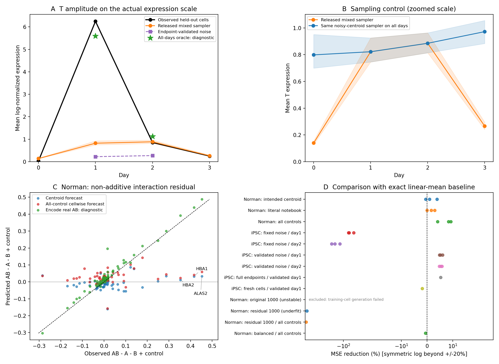

# Squidiff 本地复现与可靠性检查

> **GitHub 归档版（2026-11-14）**：保留代码、文档、评估表、图、预测 NPZ 和历史日志；不包含数据集、缓存与 checkpoint。克隆后可直接查看结果；新的模型推理需要重训。上传、迁移环境、重建数据与训练步骤见 [归档与复用指南](docs/ARCHIVE_AND_REUSE.md)。仅验证归档可运行 `python scripts/verify_archive.py`，无需数据、GPU 或第三方 Python 包。

在本地 **A100 40GB**、独立 conda 环境 **`squidiff`** 中完成。使用作者公开模型与扩散代码、适配后的训练入口从头训练；本轮新增 **15 次各 100000 步的正式训练**，保留第一轮 v1 两个模型及全部失败记录。训练/评估完成于 **2026-11-13 21:56（北京时间）**。

**结论：修正本地复现差异后，仍未验证准确恢复非加性交互和真实瞬态程序的强结论。** 模型存在小幅均值预测增益，整体相关性可以很高；这些分数不足以支持较强的生物学解释。这个判断限于本次 Norman 与 iPSC 任务；论文其他药物/BVO 实验未在本轮检验，作者原始单次运行的逐点验证仍受对应制品缺失限制。

## 核心结果

下表保留三个预先指定训练种子 42/43/44，报告平均值。Norman使用全部7353个控制细胞的细胞级潜变量平移；iPSC噪声仅按独立端点验证数据选择。R²以真实表达为参考；基线使用全部训练细胞的精确均值。

| 实验 | 模型R² | 线性基线R² | 模型MSE相对基线 | 关键结果 |
|---|---:|---:|---:|---|
| Norman双扰动 | 0.98344 | 0.98215 | 降低7.2% | 交互残差R²仅0.062 |
| iPSC day1 | 0.64905 | 0.62912 | 降低5.4% | T：预测0.223，真实6.250 |
| iPSC day2 | 0.76136 | 0.74798 | 降低5.3% | T：预测0.270，真实0.854 |

不同基因表的R²不能直接横比。以上每项都与同基因、同训练数据、同目标细胞的基线比较；旧v1基因表与数值保留在原目录。

- **Norman**：交互定义为 `I=μAB−μA−μB+μCtrl`。三个模型的交互残差R²为0.030–0.083；中心点/原notebook字面版本更弱。seed42的ALAS2交互为真实0.452、预测0.042，HBA1为0.416、0.025。让同一模型编码真实AB表达时，诊断R²可达0.970，说明良好重建与正确推断交互是不同能力。
- **iPSC**：源协议固定sigma=0.7时，三个模型的day1 T均值仅0.75–0.91。端点验证校准改善均值误差，却未恢复瞬态峰；阈值0.5定义的13个day1瞬态基因，三个校准模型均恢复0个。排除T的事后分类器可识别94.8%的真实day1细胞，但校准生成样本的day1归类比例为0%；它只作辅助诊断。
- **采样负对照**：3个模型×3次噪声重复中，不施加方向移动时，T已约0.80，day1约0.82。原代码对端点编码真实细胞、对中间日使用带噪声的潜变量中心；统一四天采样方式后，9条曲线全部失去中间日富集。弱隆起本身不能证明学到了发育程序。



图中oracle、加入中间态训练的阳性对照都不计作预测成绩；阴影为9条生成曲线的范围，不是生物学置信区间。

## 检查、修复和扩展

- 原始CSV与v1各分区逐值重取最大误差为0；核对细胞顺序、基因ID、扩散公式、时间映射及采样。原采样器与本地同噪声输出一致；原CPU抽样/NumPy时间步条件下，恢复后的5步损失和权重逐位一致。移除BF16及TF32没有挽救主要失败。
- 修正第一轮基线只取部分细胞的偏差；将Norman细胞级推理从前600个控制细胞扩展为全部控制细胞。后者确有改善，不能将原先的低增益概括为完全无效。seed42的细胞bootstrap误差降低区间约0.6%–13.1%，仅反映条件细胞抽样不确定性。
- 按可恢复公开协议重训两个任务各3个种子；另跑新细胞分区、16546个端点训练细胞、Norman条件平衡抽样及1000基因版本。全端点数据缓解了过拟合，但校准后day1 T仍为0.208；新细胞分区day1/day2误差相对各自基线反而升高1.9%/21.5%。平衡抽样也未改善交互恢复。
- 1000基因原版连训练细胞生成也爆炸，已从生物学比较排除。额外的epsilon恒等残差版本从头重训，抑制了爆炸，但生成R²仍约0.90、欠拟合；它属于明确的方法扩展，不用于否定原论文的交互能力。原版、修复版及稳定性诊断均保留。
- 阳性对照额外加入中间态训练并编码真实中间态后，day1 T可达到5.59，真实6.24，重建R²约0.995。该对照训练/测试无重合。首个错误阳性对照曾有1200个测试ID重合，发现后已作废、删权重并从头重训，见 `results/rejected/`。

## 公开协议的边界

[论文](https://www.nature.com/articles/s41592-025-02877-y)；[模型代码](https://github.com/siyuh/Squidiff)固定于 `abdfc27d8494`；[作者notebook](https://github.com/siyuh/Squidiff_reproducibility)固定于 `7ce6d0291ee4`，49个文件已核验Git对象哈希。

- 数据来自Norman/GEARS公开预处理数据与作者Figshare的iPSC镜像；下载地址、MD5见 `data/raw/manifest.json`。Norman选定组合训练7890、测试257个细胞；iPSC全量36044×11231，源协议模型只训练day0/day3共2400个样本。
- 当前Norman预处理要求1000HVG，而评估加载203维模型。203维组按200HVG并集标记基因推定；作者原始203基因名单、细胞划分种子和对应训练权重未在可访问制品中找到。因此这是可恢复公开协议的检验，不能声称逐点重放了作者原始权重。
- “未恢复day1 T真实高峰”与“论文所有图表均无法复现”不同：部分整体相关性可达到论文量级，原采样方式也可得到弱中间日富集。这里的T≈6.25是公开数据的实测均值，并非论文报告的预测值；论文Fig.2所示弱富集本身不等于准确恢复这一幅度。
- 原训练循环只做过5步数值核对，原采样器同噪声输出一致；正式长程训练使用本地入口，尚未完成未经改写的原TrainLoop整程100000步对照，也未重建作者当年的完整软件栈。因此不能声称已排除所有适配影响；但多种数值设置和3个训练种子的共同失败，使一般精度/随机性问题成为主因的解释较弱。
- 源iPSC组保留作者放回抽样及端点重复，以对齐代码；严格新分区无训练/测试ID重合，HVG只由端点训练细胞选择。原协议HVG发现接触四天发现分区，不能称整条流程完全不接触中间条件。
- notebook的iPSC R²参数顺序颠倒，输出同时保留两种口径；端点高分来自真实端点编码重建；同一权重多次生成属于采样重复。Norman反向比例对小样本共同控制参考敏感，约8%的原口径数值也可得到，不能与全控制均值口径直接比较。

## 运行、断点与资料

环境：Python3.10、PyTorch2.5.1/CUDA12.1、Scanpy1.10.4；锁定信息见 `environment.yml`、`requirements-lock.txt`，新机器安装入口为 `bash scripts/setup_env.sh` 和 `environment-portable.yml`。原网络主体为2048隐层、3个MLP块、60维语义编码器；1000步线性扩散，batch64，AdamW，lr=1e-4线性衰减。源协议组使用IEEE FP32和原CPU抽样方式。

```bash
conda activate squidiff
python scripts/verify_archive.py
python scripts/status.py
```

`status.py` 展示归档的历史训练记录，不代表克隆后拥有对应权重。重新训练请先按[复用指南](docs/ARCHIVE_AND_REUSE.md)隔离旧结果/完成标记，再依次运行 `download_data.py`、`prepare.py norman`、`prepare.py ipsc`、`prepare_research.py`，最后训练与评估。原机器有权重时可运行 `final_integrity.py`；归档克隆后用 `verify_archive.py`。本地训练每5000步原子保存完整模型、EMA、优化器及全部随机状态，调度器保留最终/50k模型和完整续训状态；这些权重不进入 Git。磁盘低于20GiB停止启动新任务；冗余checkpoint清理记录在 `logs/checkpoint_retention.jsonl`。

主要资料：

- `results/research/assessment.json`：完整实验清单、完成状态、检查及限制。
- `all_controlled_metrics.csv`、`source_all_control_seed_summary.csv`、`input_conditioned_baselines.csv`：位于 `results/research/`，保留全部模式和种子。
- `sampling_null_summary.csv`、`transient_programs/`、`population_diagnostics.csv`、`conditional_uncertainty/`：同目录，分别记录负对照、瞬态程序、群体状态和条件抽样区间。
- `results/{norman,ipsc}/{run}/`：训练日志、预测NPZ、逐基因表及配置；权重只保存在原机器，不进入归档。`results/research/sampling_failures_excluded_from_biological_comparison.csv`保留被排除的生成失败数值。
- `logs/events.jsonl`及 `logs/README_research_full_20261113.txt`：完整过程记录；当前README为压缩整理版。

## 关键时间（2026-11-13，北京时间）

| 时间 | 事件/决定 |
|---|---|
| 12:54；13:03；13:18 | 创建squidiff环境；开始首版Norman、iPSC训练 |
| 13:33；14:22 | 首版结束；复核后撤回“核心科学结论已复现”的判断，修正精确基线 |
| 18:37–19:40 | 启动细审、FP32/IEEE配对训练；排除主要数值适配原因 |
| 19:00–19:16 | 作废有重合的阳性对照，修复为4800个训练细胞后从头训练并验证 |
| 19:46 | 数值一致性验证后启用私有MPS队列，完整恢复中断训练 |
| 20:09–20:53 | 完成两任务各3个公开协议训练种子及首批评估 |
| 20:28；20:48 | 加入条件平衡训练、全端点数据扩展，排查样本不平衡和过拟合 |
| 21:12 | 启动仅端点验证的噪声校准，参数选择不读取中间日测试数据 |
| 21:24；21:35 | 定位1000基因生成爆炸；单列epsilon残差稳定化重训 |
| 21:56；22:14 | 新增15次训练及受控检查结束；完成文件一致性核验、文档整理和GPU释放 |

后续若要逐点核对作者原始运行，需要对应checkpoint、基因名单和细胞划分。若目标是改进方法，应引入可检验的轨迹/交互约束或额外信息，并在独立供体/组合上验证；继续盲目增加训练步数不能替代这些检验。
