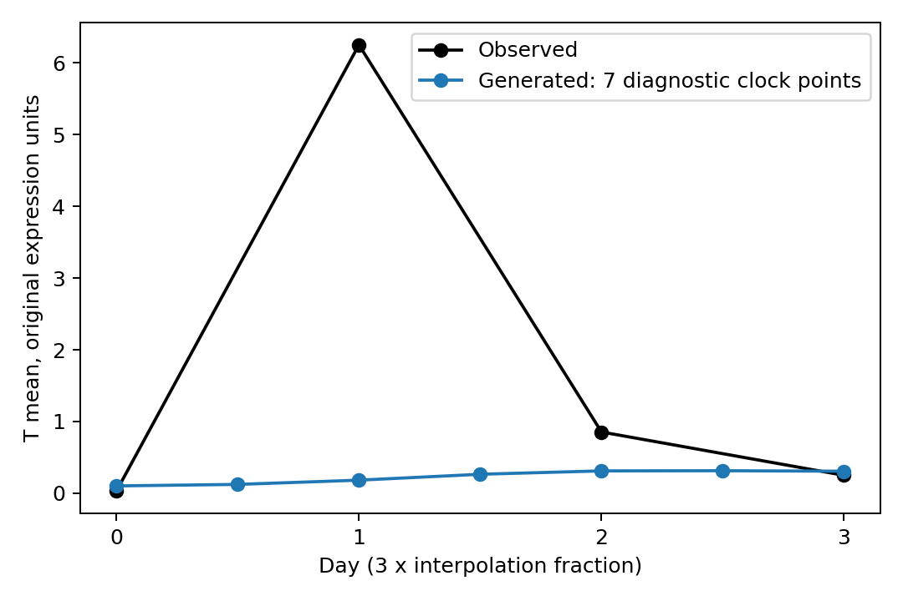
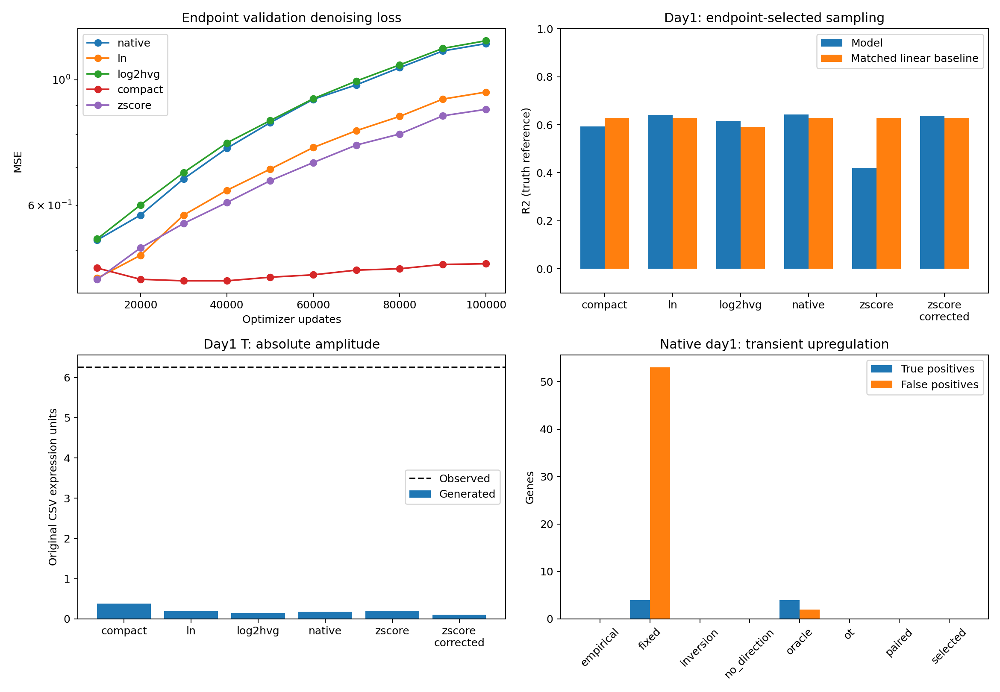
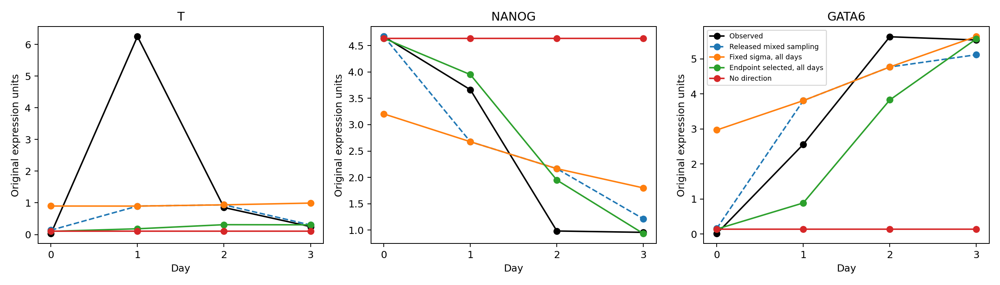
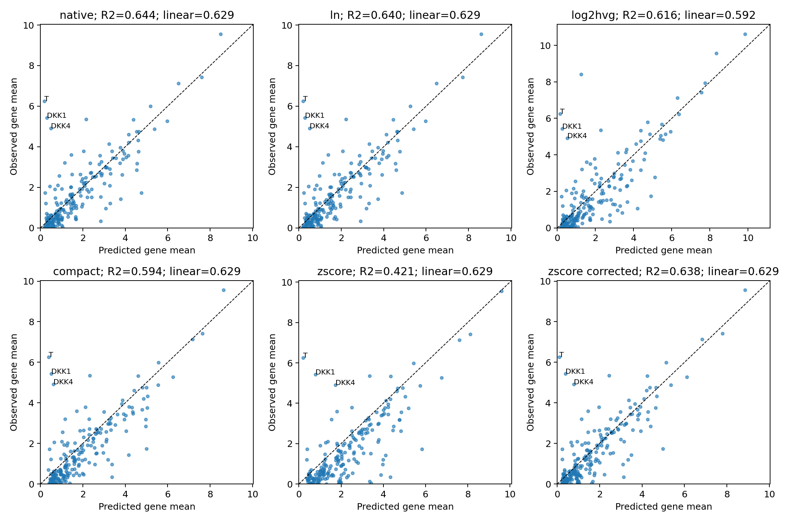

# Squidiff 第二轮复现：issue #8 线索与 day1 专项实验

完成日期：2026-11-15。本轮在本机 A100 40GB 上新增 **5 个从头训练的正式版本，每版 100000 次更新，共 50 万次主轨迹更新**；另做中断恢复工程检查、早期/早停对照、采样变体和插值时钟诊断。最后一个训练于北京时间 12:06:56 完成，最后一次诊断采样于 12:14:12 完成，随后整理并复核本报告。

**结论：仍未完成真实 day1 瞬态状态的准确复现。** 本轮补上了原生 `TrainLoop` 的完整长程对照，修正并验证了 z-score 与采样裁剪下界的不兼容，尝试了表达尺度、HVG 对数底、小网络正则化、经验潜变量分布、端点运输配对和随机编码保留。部分整体指标有小幅收益，但 T/DKK1/DKK4 的真实中间态高表达仍然缺失。这个结论比“所有图都无法重画”窄，也不把部分高相关性当成生物学复现成功。

## 阅读结论与实验边界

已阅读[论文](https://www.nature.com/articles/s41592-025-02877-y)的[公开作者稿](https://pmc.ncbi.nlm.nih.gov/articles/PMC12872408/)正文、发表版 Fig.2、补充图、本地 `report.md`、原始网络/扩散/训练/采样实现，以及作者 Fig.2 预处理和推理 notebook；在线重新读取 [issue #8 全部讨论](https://github.com/siyuh/Squidiff/issues/8)。GitHub API 复核[模型仓库](https://github.com/siyuh/Squidiff)最新提交仍为 `abdfc27d84947dcccd745d1067c0840a41d32eb8`，[复现仓库](https://github.com/siyuh/Squidiff_reproducibility)仍为 `7ce6d0291ee489d1fd89dda5abe8d4f993450d6e`。本轮不改写旧结果、不将历史训练计作新增训练。

issue 中的线索需要区别处理：

1. 提问者用原始计数做 normalize_total(1e4)+log1p，强制加入大量标记基因；作者后续 notebook 直接使用已归一化的 CSV，取 200 HVG 与 NANOG/T/GATA6 的并集。这是不同的数据协议，不能照着问题描述再次归一化已有 CSV。
2. 一位参与者报告不做 z-score 后成功；另一位参与者明确说未做 scaling 仍失败。它是需要对照的线索，不是已证实的充分条件。旧本地 source 版本本来就未做 z-score。
3. 作者在 [2026-03-21 的回复](https://github.com/siyuh/Squidiff/issues/8#issuecomment-4104914471)中表示已发布数据处理和 checkpoint。该声明与制品检查分别记录；重新查询 Figshare 仍为 v3，公开 `VO_diff_model.pt` 为 596 维 BVO 模型，不能加载为这里的 203 维 iPSC Fig.2 模型。原 notebook 指向的 `fig2_model.pt` 仍未在可访问制品中找到。

论文的“整体分数”和“恢复真实瞬态”分别评价。公开 notebook 的 R² 参数颠倒，本报告同时给出正确参考方向与 notebook 方向；论文图示的 day1 Pearson 约 0.85 不等于真实 T 峰的精确恢复。原始权重、原基因表和划分种子仍不能精确恢复，因此本轮是固定可恢复协议的从头训练检验。

历史工作已经取得过 v1 day1 Pearson=0.8943、常规 R²=0.7009；source 三种子经端点校准的 day1 R² 均值约 0.6491，匹配线性基线为 0.6291，但 T 均值只有约 0.223。v1 与 source 只重合 91 个基因，不能直接把这些数值的差别归因于模型训练。Norman 的强交互恢复在旧实验中也未得到验证；本轮新增训练集中检验 Fig.2 iPSC，不将这一结果外推到论文全部任务。

## 冻结的实验方案

训练只用 source day0/day3 的 2400 行（2237 个唯一细胞），验证只用无训练 ID 重合的 400 个端点细胞。day1/day2 不用于学习率、checkpoint、采样参数选择。保留源协议端点训练/测试的 **163 个 ID 重合**；中间日没有训练 ID 重合，不声称供体隔离。HVG 发现沿用作者四天发现分区，不能称完全没有使用中间态信息。source 为 203 基因，log2hvg 为 202 基因，共同 135 基因；根据实际维度建模，没有为了凑 203 随意删补。

这些中间日数据在历史工作和本轮诊断中已经被多次查看，属于复现/开发诊断数据，不能作为新方法从未接触的最终确认集。本文不以测试分数选择训练种子、HVG 面板或训练终点。

| 版本 | 改动 | 目的 |
|---|---|---|
| native | 原 `TrainLoop` 的更新流程，原 2048×3 网络，非负 CSV 表达 | 补上原生长程训练对照 |
| ln | source 同细胞、同基因，输入乘 ln(2)，评估转换回 CSV 单位 | 隔离表达尺度对信噪比及生成的影响 |
| log2hvg | 声明 base=2 后的 HVG 并集，表达值不变 | 检验上轮发现的 HVG 对数底敏感性 |
| compact | 512 隐层，weight decay=1e-4，编码潜变量 0.1×批内 RMS 噪声 | 检验过拟合和局部潜空间鲁棒性；属于方法扩展 |
| zscore | 只由训练端点计算逐基因均值/标准差 | 直接检验 issue 的 scaling 线索及与非负采样器的冲突 |

每版均为 100000 次更新、batch64、lr=1e-4 线性衰减、1000 步线性扩散、IEEE FP32、seed42。以独立端点去噪损失保存 best，固定终点 final 单列。采样同时给固定 σ=0.7 和端点验证选择结果；候选限定为 σ=0、0.5×RMS、1×RMS、固定 0.7、经验残差混合、逐细胞平移和端点运输配对。选取准则为端点平均逐基因 Wasserstein。数据包装只给训练过程表达矩阵与 Group；元数据中的 pseudotime、PC1、donor 等没有作为模型输入。

先用 100 DDIM 步筛查采样稳定性，再以完整 1000 步确认主要对照。更换 HVG 面板时同时报各自匹配线性基线和共同基因指标，避免用原始 R² 横向挑选容易面板。day1 瞬态基因由真实均值超过两端点最大均值 0.5 定义，同时报告召回、错误上调及 T 的幅度/高表达细胞比例。oracle 编码真实目标只作为重建诊断，绝不计为预测。

生成与真实细胞没有逐行配对关系，因此不将按任意行顺序展平后的单细胞 R² 作为主要指标。除跨基因均值外，同时使用逐基因 Wasserstein 和联合表达 energy 的 V 统计量 `2·mean||X−Y||−mean||X−X′||−mean||Y−Y′||`（包括样本对角线、未开平方）。同一权重的多次采样不算独立训练重复。

进一步加入两个不接触真实中间日的推理对照：在训练端点标准化语义残差上求一对一最优运输配对，然后插值；以及按原 `stochastic_encode` 的 DDIM 逆过程保留 day0 的随机编码，再平移语义编码。二者都是显式推理变体，不混称为作者 notebook 的默认方式。

表中的 `empirical` 用端点真实语义残差作归一化混合，系数 1 不是“高斯 σ=1”；`paired` 是逐细胞潜变量平移，`ot` 才是端点运输配对。`no_direction` 与主方案匹配采样、移除方向；`oracle` 编码真实目标 RNA 后从随机 xT 生成，只作条件生成诊断，不是保留目标完整随机编码的可逆重建。补充的端点 MSE 选参和七点时钟扫描是在主方案之后增加的诊断，未修改正式预测的比例或训练设置。

全部新增制品保存在 `results/round2/`，日志在 `logs/round2/`，数据审计在 `results/round2/data_audit.json`；入口为 `scripts/round2.py`。训练环境使用机器现有 `/home/whs/mydata/conda-env/squidiff/bin/python`（Python3.10，PyTorch2.5.1+cu121，Scanpy1.10.4），完整包列表见 `docs/round2/requirements-freeze.txt`。

## 运行结果

**原生完整训练没有救回 day1。** 固定公开 σ=0.7 时，day1 Pearson=0.7440、常规 R²=0.3488、notebook 方向 R²=0.0561，未匹配论文图中的数值。按独立端点验证选择经验潜变量残差采样后，R²=0.6435，匹配线性基线为 0.6291，均值 MSE 改善 **3.9%**；但 T 仅 **0.1824**，真实为 **6.2501**，生成细胞 T>3 的比例为 **0%**，真实约 **94.3%**。13 个真实瞬态上调基因的阈值恢复数为 0。这里的 6.2501 是公开测试数据实测值，不是作者报告的预测值。

表达尺度转换的 day1 R² 为 0.6405，相对同面板线性基线 MSE 改善 3.1%；log2-HVG 版为 0.6163，相对自己的基线 0.5919 改善 6.0%。两者 T 分别仅 0.1942/0.1499，均未恢复瞬态基因。小网络版虽然去噪验证损失更稳定，day1 R²=0.5938，却低于自己的基线，T=0.3815。不同面板另有共同 135 基因对照，不能直接用上述原始 R² 排名方法。

**issue 的 scaling 线索被实际验证，但不是完整救援。** 对同一 z-score 权重，仅把采样时 x0 的下界从标准化坐标 0 改为物理表达零对应的 `−训练均值/训练标准差`，端点校准后的 day1 R² 从 **0.4211 提升到 0.6383**。这是真实的工程改善；然而 T=0.1019，瞬态恢复数仍为 0。正确使用标准化需要匹配的采样坐标，不能简单解释为“标准化在生物学上一定不该用”；旧的未标准化 source 版本来也失败，因此它不能成为所有失败的解释。

保留 day0 随机编码、逐细胞平移、端点最优配对也没有恢复真实峰：原生 day1 R² 分别为 0.6196/0.6381/0.6295，T 分别为 0.0432/0.1650/0.1350。改用端点均值 MSE 选参的补充对照同样未救回瞬态，完整结果单列；它没有按 day1 的分数挑选候选。不是所有设置都比线性基线更好，也没有把失败结果删去。

原生主方案的均值误差确有小幅下降，但其 day1 联合分布 energy 约 6.69，端点细胞混合基线约 5.85；均值分数改善不能自动推出联合状态恢复。原生误差分解中，T/DKK1/DKK4 合计占均值平方误差的 **43.1%**，13 个瞬态上调基因占 **57.8%**，所以并非单个 T 基因的问题。另一个反例是原生 OT 推理的 notebook MMD 仅约 `6.6e-5`，T 却只有 0.135；该 MMD 比较的是基因均值的一维分布，不足以证明基因身份和联合细胞状态正确。

## 对仍未复现的解释

**第一，训练目标没有约束实际的生物学时间路径。** 编码器和去噪器只在端点细胞上学习自编码/噪声预测；扩散时间步是噪声强度，日龄比例则在推理时外加。两端点本身不能唯一决定中间轨迹，例如 `μ(α)=(1−α)μ0+αμ3+c·α(1−α)` 对任意 c 都有相同端点。神经网络可以给出某条非线性路径，但低端点损失不能保证它恰好包含真实的 T/DKK 瞬态群体扩张。这是可识别性问题的解释，不是证明所有端点方法都不可能成功。

**第二，真实编码分布与任意高斯噪声中心不是同一个条件生成问题。** 原方法没有把语义潜变量训练成固定单位高斯；潜变量可以缩放而由解码器权重反向补偿，固定 0.7 没有跨训练运行的自然尺度。经验残差使用真实端点编码的相关结构，确实改善了生成和整体均值，但它仍只是端点分布之间的假设路径，并没有获得中间态特异信息。单纯改 σ 或改为细胞级运输不能补上这一点。

**第三，弱中间日富集可以来自不一致的采样方式。** 用本轮同一个 native 权重，端点采用真实端点编码、day1/day2 用固定噪声中心时，T 曲线是 **0.139 → 0.898 → 0.938 → 0.302**，看上去存在中间日富集。四天统一用固定噪声中心后，变成 **0.900 → 0.898 → 0.938 → 0.993**，中间峰消失。这个对照说明本地的弱富集不能独立证明学到了瞬态；它不等于断言作者每张图都由同一机制产生。主方案施加方向仍改善了部分整体表达，不能概括成方向完全无效。

**第四，不能只归因于插值直线或训练没跑够。** 用真实 day1 RNA 编码、再从随机 xT 条件生成的原生 oracle 诊断，R²=0.7938，但 T 仍只有 0.3523。这不是预测成绩，也不是保留完整随机编码的可逆重建；它说明未见状态的条件生成本身也不足，不能断言“只要找对潜变量路径就能完全恢复”。原生去噪验证损失从 10k 的 0.521 增至 100k 的 1.158，而较早权重的实际生成更差；缩小网络也没解决。因此既不能用低训练损失证明成功，也不能只凭去噪验证最低点选择生成模型。

**第五，现有工程空白缩小了，原作者运行仍不是逐点重放。** 本轮实际完成原训练核心及默认 AdamW 的 100k 对照，补上了上轮只有短程核验的不足；它与先前适配入口得到相同的主要失败现象。仍缺少对应 Fig.2 的原权重、确切基因名单/细胞划分和作者当时的软件栈。每个新版本只有一个训练种子，当前中间日已被反复查看，HVG 也具有源协议的跨日发现信息。这些限制不允许把结果外推成论文所有实验无效，更不构成对作者动机的判断。

作为额外诊断，固定原生模型和已选定的经验残差采样，在 α=0、1/6、1/3、1/2、2/3、5/6、1 共七点检查时钟，采样网格上的 T 最高仅 **0.3139**。没有在这些点发现“峰已经学到，只是时间比例错位”的救援。它只是有限网格检查，不是连续区间的数学上界；正式 day1 比例始终为 1/3。



如果目标是按可获得公开协议准确恢复 day1，本轮的结论仍为未成功。若继续改进方法，更有依据的方向是加入可检验的中间态/外部时间序列/培养刺激时序或调控先验，并以独立供体或实验批次评价，同时保留简单端点混合和轨迹基线；这属于新方法研究。继续挑种子、换展示基因、调 σ 到 T 看起来升高，不能替代这些验证。

## 实现验证与运行记录

- `scripts/round2_audit.py` 核对插入验证前后五次原生更新的全部权重和缓冲区，最大差为 0；CPU/CUDA/NumPy 随机状态一致。修正标准化坐标裁剪后，在 center=0、scale=1 的退化情况下，与原采样器完整轨迹最大差为 0。
- 新训练继承作者原 `run_loop`、`run_step`、`forward_backward`，不改扩散目标。重写保存/观察方法；原生版本保留原梯度范数日志，其余版本关闭仅用于日志的逐参数同步范数计算。每 1000 步清除已反传的损失历史，以免保留无用计算图。没有用中间日修改优化更新。
- **补上一个实质的优化器细节。** 旧 `scripts/train.py` 在 `optimizer=source` 时显式传入 `fused=False`；PyTorch2.5.1 的 `adamw()` 只有在 `fused is None and foreach is None` 时自动选择 GPU foreach 路径，显式 False 会转入单 tensor 路径。本轮直接使用作者 `TrainLoop` 内的默认 AdamW 调用，保留原默认分发。两者都是非 fused，但不能叫逐位相同的优化器路径。安装环境中的函数原文保存在 `docs/round2/adamw_dispatch.txt`。这是本轮原生整程对照必要的理由，也解释了为什么不能用旧的少量更新核对代替完整对照。
- 首次 compact 启动因日志同步开销过大，在约 1000 步后终止并保留为 `compact_aborted_preflight`，从头重新训练。前 1000 步平均损失完全相同；该中断运行不计入正式版本数。
- MPS 切换后首次恢复遇到 `train_data_sha256` 生成晚于校验的入口错误，未执行新的优化更新，修正顺序后由完整 checkpoint 恢复。额外用真实 CLI 对 compact seed7777 做了中断恢复与连续训练各 2000 步对照，全部参数和缓冲区最大差为 0，见 `cli_resume_audit.json`；该工程检查不算正式训练重复。
- 敏感性版本 `native_logs` 中的梯度/参数范数零值是关闭同步范数日志时的占位值，不能解释成真实梯度为零；实际损失、权重和生成结果独立检查。正式 native 版本保留原范数计算。
- 原 CLI 的 `type=bool` 会把命令行字符串 `False` 转成真；本轮通过明确的 Python 布尔配置构建模型，药物条件关闭、编码器开启，不受该歧义影响。不能仅凭 issue 中的命令断言提问者实际运行受到了这一错误影响。
- 核验原生 `best.pt` 与 `step_010000.pt` 的全部参数及缓冲区完全相同后，复用已完成的 1000 步推理；`eval_best_1000/reuse.json` 保留依据。它不是新的采样重复。
- 首次汇总原生完整结果时，绘图的 `GroupBy.observed` 与列名冲突导致报告队列暂停；改为显式索引列后恢复，训练及已保存的预测不受影响。原错误与恢复日志均保留。
- 为保存剩余 checkpoint 清理了约 1.45GB 可重新下载的 PyTorch/cuDNN pip 下载缓存，清单见 `logs/round2/cache_cleanup.json`。
- 10000 步 native 的 100 DDIM 步检查出现生成膨胀：固定 σ 的 day1/day2 R² 很低，不能把 T 的虚高或瞬态召回提高解释为恢复成功。该检查保留在 `eval_step_010000_100/`，不作为正式生物学结果。

补读的 [Research Square 原始预印本](https://doi.org/10.21203/rs.3.rs-5467781/v1) 方法段写了 500 基因与 lr=1e-3，和后续发表描述/公开 notebook 不同。本轮按可执行的最终公开代码与 203 维任务执行，不把早期预印本超参数当成已确认的发表配置。预印本 PDF 和提取文本保存在 `docs/round2/`。

## 新增的数据与失败模式证据

source 训练 day0/day3 的 T 均值分别为 0.0426/0.2407，T>3 的细胞比例为 0.5%/3.83%；真实测试 day1 均值为 6.2501，高表达细胞约 94.3%。端点仍存在少数 T 高表达细胞，所以不能说模型“完全没有见过 T 高表达”。难点是恢复中间日高表达群体的大幅扩张。

用训练端点和真实测试细胞合并、按 ID 去重，要求每个层级 day0/day1/day3 至少分别有 2 个细胞（供体）或 5 个细胞（experiment），得到 69 个合格供体和 18 个合格实验批次。**69/69 供体、18/18 批次的 T day1 均值均超过两端点最大均值 0.5**；DKK1 分别为 65/69、18/18，DKK4 为 45/69、11/18。它支持瞬态峰并非少数供体构成差异；这只是描述性分层检查，不是供体隔离的泛化验证。详见 `marker_stratified.csv`、`marker_stratified_summary.json`，可由 `scripts/round2_data_audit.py` 复算。

原生 10000 步模型、完整 1000 DDIM 步、固定 σ=0.7 时，day1 T 已达到 **4.514**，但整体 R² 为 **−14.610**，203 个基因全部被叫作瞬态上调，真实只有 13 个，即 **190 个假阳性**；单个生成值最高 139.27。这是生成膨胀，不是 day1 恢复，也说明只扫描噪声使 T 接近真实峰会得出错误结论。端点选噪声和最终模型结果另表给出，失败结果没有删除。

额外尝试根据元数据 `size_factor` 回算近似整数计数，以辨认 CSV 对数底，结果不能提供决定性证据；该数据元数据包含 Salmon 定量字段，其 abundance/NumReads 是估计量，不能假定为整数，参见 [Salmon 官方文件格式说明](https://salmon.readthedocs.io/en/latest/file_formats.html#quantification-file)。因此不将整数回算误差用于判断对数底或调整训练。保留 `log_base_integer_audit.csv` 作为未能支持判断的记录；log2 相关版本仍明确是敏感性对照。

## 完成情况与校验范围

五个正式 `status.json` 均为 trained、100000 步；最终权重全部有限，两个编码器 BN 层各记录 100000 次训练更新。六个数据分区与公开 CSV 构建的完整缓存逐值一致，输入和上游源码哈希匹配，历史归档 **1029 个文件**的 SHA256 全部保持一致。见 [final_checks.json](results/round2/final_checks.json)。

[integrity.json](results/round2/integrity.json) 核验了 **110 条预测记录**的基因顺序、有限性和重新计算的均值 MSE；其中包括早期失败、端点/诊断控制及同权重复用，不是 110 次独立训练。七点时钟诊断复用四份正式预测、额外生成三份，另有 [网格校验清单](results/round2/native_path/integrity.json)。完整参数、数据面板、失败日志、预测 NPZ 和逐基因表均保留。

短程观察逻辑、2000 步真实 CLI 恢复的一致性检查，以及正式运行的更新计数，各自验证不同事项；它们不等于证明与作者当年 H100/软件栈的整程逐位一致。本轮没有对外发布、修改旧结论表或发送联系作者的消息。

本轮完成状态见 [assessment.json](results/round2/assessment.json)，全部新增交付文件的内容哈希见 [delivery_manifest.json](results/round2/delivery_manifest.json)，脚本版本见 [source_manifest.json](docs/round2/source_manifest.json)。训练/推理进程均已结束，私有 MPS 已关闭，GPU 显存已释放。

## 代码、证据与复算入口

| 文件 | 用途 |
|---|---|
| `scripts/round2.py` | 固定面板、五个模型版本、原生训练更新、完整状态恢复、端点采样选择及推理对照 |
| `scripts/round2_audit.py`、`round2_cli_audit.py` | 验证观察逻辑和真实 CLI 中断恢复的数值一致性 |
| `scripts/round2_final_integrity.py` | 检查 10 万次 BN 更新计数、权重有限性、原始表达逐值一致和历史归档哈希 |
| `scripts/round2_data_audit.py` | 标记基因幅度、供体/实验分层检查 |
| `scripts/round2_distribution_baselines.py` | 不使用中间态的逐细胞插值与端点混合基线 |
| `scripts/round2_summary.py` | 从实际完成的文件复核预测、汇总完整表并生成图 |
| `scripts/round2_reuse_equivalent.py` | 逐值确认同一权重后复用已完成推理，避免把重复计算计作新实验 |
| `scripts/round2_secondary_selection.py` | 在同一端点候选表上作均值 MSE 选参的补充检查 |
| `scripts/round2_path.py` | 在固定模型和已选采样方式上检查七点时钟网格，正式预测比例保持不变 |
| `scripts/round2_schedule.py`、`round2_evaluate_queue.py` | 本机训练/评估队列；历史 PID 迁移过程见日志，不应照搬到另一台机器 |
| `docs/round2/hvg_features.json`、`data/round2/*/manifest.json` | 冻结基因列表、细胞规模和输入文件哈希 |
| `results/round2/*_s42/config.json`、`status.json`、`train.jsonl` | 完整超参数、真实完成步数与训练/验证曲线 |
| `results/round2/*_s42/eval_*/` | 候选验证、选择依据、逐基因均值、指标与细胞级预测 NPZ |
| `results/round2/integrity.json` | 每份预测的 SHA256、重算均值 MSE 误差和正式训练完成情况 |
| `logs/round2/` | 包括失败、中断、MPS 调度和缓存清理的原始日志 |

现有本机环境和权重下，复算完整推理可使用：

```bash
SQUIDIFF_PY=/home/whs/mydata/conda-env/squidiff/bin/python
$SQUIDIFF_PY scripts/round2.py evaluate --variant native --sample-steps 1000 --full
$SQUIDIFF_PY scripts/round2.py evaluate --variant zscore --sample-steps 1000 --signed
$SQUIDIFF_PY scripts/round2_data_audit.py
$SQUIDIFF_PY scripts/round2_distribution_baselines.py
$SQUIDIFF_PY scripts/round2_summary.py
```

`--checkpoint best.pt` 对应独立端点去噪验证选出的权重。数据准备仅在首次构建时运行 `round2.py prepare`；依赖已有 source 数据和公开完整矩阵缓存，不应在复算现有权重时改写输入文件。新的独立训练可使用 `round2.py train --variant ln --seed 43 --steps 100000`，随后评估时也指定 `--seed 43`；同名已存在运行默认拒绝覆盖，续训需显式 `--resume`。本轮各模型完整优化器/RNG 状态在 `latest.pt`，固定终点在 `final.pt`，权重遵守仓库原 `.gitignore`，保留在本机。

<!-- ROUND2_GENERATED_START -->

## 新增正式训练与完整采样结果

下表均为新增模型的固定 100000 步权重、1000 DDIM 步采样。MSE 改善为 `1−模型 MSE/匹配线性基线 MSE`，负值表示退步。TP/FP 针对超过端点最大均值 0.5 的上调基因。每个版本只有一个独立训练种子，采样重复不等于独立训练。

| 版本 | day | 采样 | Pearson | R² truth | R² notebook | 线性 R² | MSE 改善 | T 预测 | T>3 比例 | TP/FP（真实数） |
| --- | --- | --- | --- | --- | --- | --- | --- | --- | --- | --- |
| compact | 1 | fixed | 0.6683 | -0.1061 | -0.5394 | 0.6291 | -198.2% | 1.3260 | 14.5% | 8/107 (13) |
| compact | 1 | selected | 0.8017 | 0.5938 | 0.5291 | 0.6291 | -9.5% | 0.3815 | 0.5% | 1/5 (13) |
| compact | 2 | fixed | 0.8316 | -0.2493 | -0.1636 | 0.7480 | -395.7% | 1.4037 | 15.8% | 5/130 (5) |
| compact | 2 | selected | 0.8218 | 0.5615 | 0.5541 | 0.7480 | -74.0% | 0.4248 | 0.5% | 1/6 (5) |
| ln | 1 | fixed | 0.7520 | 0.4063 | 0.1136 | 0.6291 | -60.1% | 0.8032 | 5.5% | 4/45 (13) |
| ln | 1 | selected | 0.8092 | 0.6405 | 0.5743 | 0.6291 | 3.1% | 0.1942 | 0.0% | 0/0 (13) |
| ln | 2 | fixed | 0.8834 | 0.4514 | 0.3881 | 0.7480 | -117.7% | 0.8496 | 6.5% | 2/53 (5) |
| ln | 2 | selected | 0.8881 | 0.7353 | 0.7280 | 0.7480 | -5.0% | 0.3342 | 0.7% | 0/0 (5) |
| log2hvg | 1 | fixed | 0.7502 | 0.2500 | 0.0595 | 0.5919 | -83.8% | 0.7606 | 4.7% | 6/50 (15) |
| log2hvg | 1 | selected | 0.7943 | 0.6163 | 0.5218 | 0.5919 | 6.0% | 0.1499 | 0.0% | 0/0 (15) |
| log2hvg | 2 | fixed | 0.8815 | 0.4595 | 0.4010 | 0.7606 | -125.7% | 0.8245 | 5.2% | 2/62 (7) |
| log2hvg | 2 | selected | 0.8906 | 0.7594 | 0.7278 | 0.7606 | -0.5% | 0.2712 | 0.5% | 0/0 (7) |
| native | 1 | fixed | 0.7440 | 0.3488 | 0.0561 | 0.6291 | -75.6% | 0.8980 | 6.2% | 4/53 (13) |
| native | 1 | selected | 0.8093 | 0.6435 | 0.5709 | 0.6291 | 3.9% | 0.1824 | 0.0% | 0/0 (13) |
| native | 2 | fixed | 0.8811 | 0.3696 | 0.3183 | 0.7480 | -150.1% | 0.9376 | 6.8% | 2/71 (5) |
| native | 2 | selected | 0.8888 | 0.7500 | 0.7342 | 0.7480 | 0.8% | 0.3117 | 0.2% | 0/0 (5) |
| zscore | 1 | fixed | 0.6517 | -3.0068 | -2.0832 | 0.6291 | -980.4% | 1.3179 | 12.8% | 13/189 (13) |
| zscore | 1 | selected | 0.7712 | 0.4211 | 0.3729 | 0.6291 | -56.1% | 0.2036 | 0.0% | 3/24 (13) |
| zscore | 2 | fixed | 0.7773 | -3.7189 | -1.8702 | 0.7480 | -1772.4% | 1.3877 | 13.0% | 5/196 (5) |
| zscore | 2 | selected | 0.8603 | 0.3518 | 0.4504 | 0.7480 | -157.2% | 0.3126 | 1.2% | 1/37 (5) |

端点验证实际选中的方案（本表不使用 day1/day2 排序）：

| 版本 | 潜变量方式 | σ/系数 | 端点 Wasserstein |
| --- | --- | --- | --- |
| native | empirical | 1.0000 | 0.5156 |
| ln | empirical | 1.0000 | 0.5189 |
| log2hvg | empirical | 1.0000 | 0.6218 |
| compact | isotropic | 0.0000 | 0.7798 |
| zscore | empirical | 1.0000 | 1.0909 |

### day1 标记与瞬态程序的绝对幅度

| 基因 | 真实 | native | ln | log2hvg | compact | zscore 原采样 | zscore 修正下界 |
| --- | --- | --- | --- | --- | --- | --- | --- |
| T | 6.2501 | 0.1824 | 0.1942 | 0.1499 | 0.3815 | 0.2036 | 0.1019 |
| DKK1 | 5.4312 | 0.2955 | 0.2921 | 0.2549 | 0.5024 | 0.7770 | 0.3836 |
| DKK4 | 4.9115 | 0.4815 | 0.4991 | 0.5249 | 0.6060 | 1.7308 | 0.7861 |
| FST | 5.3536 | 2.1540 | 2.2181 | 2.2690 | 2.3162 | 3.3546 | 2.4504 |
| NANOG | 3.6641 | 3.9509 | 3.9530 | 3.9573 | 4.7946 | 4.0111 | 3.7879 |
| GATA6 | 2.5613 | 0.8892 | 0.9679 | 0.9350 | 1.0388 | 2.8567 | 1.4564 |

### 共同 135 基因的公平比较

| 版本 | day | 共同基因 R² | 共同基因线性 R² |
| --- | --- | --- | --- |
| compact | 1 | 0.5241 | 0.5477 |
| compact | 2 | 0.5268 | 0.6939 |
| ln | 1 | 0.5676 | 0.5477 |
| ln | 2 | 0.6791 | 0.6939 |
| log2hvg | 1 | 0.5709 | 0.5477 |
| log2hvg | 2 | 0.6939 | 0.6939 |
| native | 1 | 0.5723 | 0.5477 |
| native | 2 | 0.6975 | 0.6939 |
| zscore | 1 | 0.3091 | 0.5477 |
| zscore | 2 | 0.2805 | 0.6939 |

### 单细胞分布对照

cell_linear 为独立抽取训练端点细胞的逐细胞表达插值；endpoint_mixture 只混合端点细胞。两者都不使用中间态，固定 3 次抽样取平均。W 是逐基因 Wasserstein 均值，E 是联合表达 energy distance，均越低越好；不同面板仅在各自内部比较。

| 面板 | 方式 | day | W | E |
| --- | --- | --- | --- | --- |
| log2hvg | cell_linear | 1 | 0.9345 | 9.9627 |
| log2hvg | cell_linear | 2 | 0.8566 | 5.3156 |
| log2hvg | endpoint_mixture | 1 | 0.8381 | 8.2384 |
| log2hvg | endpoint_mixture | 2 | 0.6999 | 4.5234 |
| source | cell_linear | 1 | 0.7359 | 7.2272 |
| source | cell_linear | 2 | 0.6740 | 3.7863 |
| source | endpoint_mixture | 1 | 0.6245 | 5.8503 |
| source | endpoint_mixture | 2 | 0.5042 | 3.1623 |
| source | compact_selected | 1 | 0.8317 | 7.2179 |
| source | compact_selected | 2 | 0.8895 | 6.2819 |
| source | ln_selected | 1 | 0.6955 | 6.6482 |
| source | ln_selected | 2 | 0.6742 | 3.5887 |
| log2hvg | log2hvg_selected | 1 | 0.8492 | 9.0563 |
| log2hvg | log2hvg_selected | 2 | 0.8594 | 5.1008 |
| source | native_selected | 1 | 0.6920 | 6.6934 |
| source | native_selected | 2 | 0.6776 | 3.5430 |
| source | zscore_selected | 1 | 1.1530 | 13.0626 |
| source | zscore_selected | 2 | 1.1731 | 10.5225 |

### 原生模型推理对照

| 方式 | day | R² | T 均值 | TP | FP |
| --- | --- | --- | --- | --- | --- |
| empirical | 1 | 0.6435 | 0.1824 | 0 | 0 |
| empirical | 2 | 0.7500 | 0.3117 | 0 | 0 |
| fixed | 1 | 0.3488 | 0.8980 | 4 | 53 |
| fixed | 2 | 0.3696 | 0.9376 | 2 | 71 |
| inversion | 1 | 0.6196 | 0.0432 | 0 | 0 |
| inversion | 2 | 0.5885 | 0.0775 | 0 | 0 |
| no_direction | 1 | 0.5963 | 0.1023 | 0 | 0 |
| no_direction | 2 | 0.2771 | 0.1023 | 0 | 0 |
| oracle | 1 | 0.7938 | 0.3523 | 4 | 2 |
| oracle | 2 | 0.9232 | 0.4603 | 2 | 1 |
| ot | 1 | 0.6295 | 0.1350 | 0 | 0 |
| ot | 2 | 0.7657 | 0.2713 | 0 | 0 |
| paired | 1 | 0.6381 | 0.1650 | 0 | 0 |
| paired | 2 | 0.7154 | 0.2411 | 0 | 0 |
| selected | 1 | 0.6435 | 0.1824 | 0 | 0 |
| selected | 2 | 0.7500 | 0.3117 | 0 | 0 |

oracle 编码了真实目标表达，只用于诊断重建能力。inversion 只保留 day0 随机编码；ot 的配对只用训练端点。no_direction 移除分化方向，其余采样条件匹配 selected。

### 仅端点验证选出的早停权重

| 版本 | 更新步数 | day | 方式 | R² | T 均值 |
| --- | --- | --- | --- | --- | --- |
| native | 10000 | 1 | fixed | -14.6096 | 4.5139 |
| native | 10000 | 2 | fixed | -18.6171 | 4.5292 |
| native | 10000 | 1 | selected | -0.1395 | 0.8124 |
| native | 10000 | 2 | selected | -0.2787 | 0.8199 |
| ln | 10000 | 1 | fixed | -17.8660 | 4.9304 |
| ln | 10000 | 2 | fixed | -23.4955 | 5.1480 |
| ln | 10000 | 1 | selected | 0.0982 | 0.7786 |
| ln | 10000 | 2 | selected | -0.0142 | 0.8268 |
| compact | 40000 | 1 | fixed | -9.8280 | 6.2280 |
| compact | 40000 | 2 | fixed | -12.8187 | 6.5289 |
| compact | 40000 | 1 | selected | 0.2470 | 1.2399 |
| compact | 40000 | 2 | selected | 0.1565 | 1.3201 |

### z-score 采样下界修正

| day | 方式 | R² | T 均值 | MSE 改善比例 |
| --- | --- | --- | --- | --- |
| 1 | fixed | -1.7298 | 1.2747 | -6.3603 |
| 2 | fixed | -2.1622 | 1.3479 | -11.5476 |
| 1 | selected | 0.6383 | 0.1019 | 0.0248 |
| 2 | selected | 0.7039 | 0.2206 | -0.1748 |

### 补充：改用端点均值 MSE 选择采样参数

这是在主实验之后增加的诊断对照。仅改变端点候选表的排序指标，不重新搜索候选或按 day1/day2 选参；已有相同生成结果直接复用。主表保持原定 Wasserstein 规则。

| 版本 | 修正下界 | day | MSE 选定方式 | σ/系数 | W 选择 R² | MSE 选择 R² | T 均值 | TP | FP |
| --- | --- | --- | --- | --- | --- | --- | --- | --- | --- |
| native | False | 1 | isotropic | 0.0000 | 0.6435 | 0.5609 | 0.0516 | 0 | 4 |
| native | False | 2 | isotropic | 0.0000 | 0.7500 | 0.5726 | 0.0384 | 0 | 2 |
| ln | False | 1 | ot | 1.0000 | 0.6405 | 0.6261 | 0.1548 | 0 | 0 |
| ln | False | 2 | ot | 1.0000 | 0.7353 | 0.7461 | 0.3150 | 0 | 0 |
| log2hvg | False | 1 | isotropic | 0.0000 | 0.6163 | 0.5599 | 0.0072 | 0 | 1 |
| log2hvg | False | 2 | isotropic | 0.0000 | 0.7594 | 0.7056 | 0.0067 | 0 | 0 |
| compact | False | 1 | isotropic | 0.0000 | 0.5938 | 0.5938 | 0.3815 | 1 | 5 |
| compact | False | 2 | isotropic | 0.0000 | 0.5615 | 0.5615 | 0.4248 | 1 | 6 |
| zscore | False | 1 | isotropic | 0.2082 | 0.4211 | 0.4984 | 0.1526 | 0 | 8 |
| zscore | False | 2 | isotropic | 0.2082 | 0.3518 | 0.5779 | 0.1589 | 0 | 8 |
| zscore | True | 1 | ot | 1.0000 | 0.6383 | 0.6216 | 0.0719 | 0 | 0 |
| zscore | True | 2 | ot | 1.0000 | 0.7039 | 0.7361 | 0.1331 | 0 | 0 |







### 全部已完成推理运行的关键数值

本表包含早期失败、端点控制、oracle 和方法扩展；它们不能混合统计成独立复现成功次数。全部统计字段见 [all_metrics.csv](results/round2/all_metrics.csv)，逐基因均值和细胞级预测见各 evaluation 目录。

| 版本 | 更新步数 | DDIM 步 | 评估 | 方式 | day | R² | Pearson | T 预测 | TP/FP |
| --- | --- | --- | --- | --- | --- | --- | --- | --- | --- |
| compact | 40000 | 1000 | eval_best_1000 | fixed | 1 | -9.8280 | 0.1867 | 6.2280 | 13/182 |
| compact | 40000 | 1000 | eval_best_1000 | fixed | 2 | -12.8187 | 0.4929 | 6.5289 | 5/189 |
| compact | 40000 | 1000 | eval_best_1000 | selected | 1 | 0.2470 | 0.7412 | 1.2399 | 7/82 |
| compact | 40000 | 1000 | eval_best_1000 | selected | 2 | 0.1565 | 0.8144 | 1.3201 | 2/87 |
| compact | 100000 | 1000 | eval_final_1000 | empirical | 0 | 0.8614 | 0.9852 | 0.6078 | 0/34 |
| compact | 100000 | 1000 | eval_final_1000 | empirical | 1 | 0.5186 | 0.7933 | 0.6579 | 2/24 |
| compact | 100000 | 1000 | eval_final_1000 | empirical | 2 | 0.4772 | 0.8714 | 0.7794 | 1/41 |
| compact | 100000 | 1000 | eval_final_1000 | empirical | 3 | 0.8461 | 0.9918 | 0.8618 | 0/91 |
| compact | 100000 | 1000 | eval_final_1000 | fixed | 0 | 0.2037 | 0.8429 | 1.2648 | 0/121 |
| compact | 100000 | 1000 | eval_final_1000 | fixed | 1 | -0.1061 | 0.6683 | 1.3260 | 8/107 |
| compact | 100000 | 1000 | eval_final_1000 | fixed | 2 | -0.2493 | 0.8316 | 1.4037 | 5/130 |
| compact | 100000 | 1000 | eval_final_1000 | fixed | 3 | 0.3192 | 0.9517 | 1.4923 | 0/141 |
| compact | 100000 | 1000 | eval_final_1000 | inversion | 0 | 1.0000 | 1.0000 | 0.0310 | 0/0 |
| compact | 100000 | 1000 | eval_final_1000 | inversion | 1 | 0.6158 | 0.8044 | 0.0524 | 0/0 |
| compact | 100000 | 1000 | eval_final_1000 | inversion | 2 | 0.4221 | 0.7336 | 0.0876 | 1/2 |
| compact | 100000 | 1000 | eval_final_1000 | inversion | 3 | 0.3949 | 0.6826 | 0.1386 | 0/4 |
| compact | 100000 | 1000 | eval_final_1000 | no_direction | 0 | 0.9450 | 0.9932 | 0.3569 | 0/10 |
| compact | 100000 | 1000 | eval_final_1000 | no_direction | 1 | 0.5568 | 0.7878 | 0.3569 | 0/10 |
| compact | 100000 | 1000 | eval_final_1000 | no_direction | 2 | 0.2457 | 0.6836 | 0.3569 | 0/10 |
| compact | 100000 | 1000 | eval_final_1000 | no_direction | 3 | 0.1567 | 0.5551 | 0.3569 | 0/10 |
| compact | 100000 | 1000 | eval_final_1000 | oracle | 0 | 0.8688 | 0.9852 | 0.5333 | 0/32 |
| compact | 100000 | 1000 | eval_final_1000 | oracle | 1 | 0.6748 | 0.8846 | 0.8606 | 10/41 |
| compact | 100000 | 1000 | eval_final_1000 | oracle | 2 | 0.6596 | 0.9508 | 0.9766 | 4/50 |
| compact | 100000 | 1000 | eval_final_1000 | oracle | 3 | 0.8587 | 0.9920 | 0.7725 | 0/76 |
| compact | 100000 | 1000 | eval_final_1000 | ot | 0 | 0.8688 | 0.9852 | 0.5333 | 0/32 |
| compact | 100000 | 1000 | eval_final_1000 | ot | 1 | 0.5666 | 0.7998 | 0.5090 | 0/12 |
| compact | 100000 | 1000 | eval_final_1000 | ot | 2 | 0.5593 | 0.8613 | 0.6098 | 0/10 |
| compact | 100000 | 1000 | eval_final_1000 | ot | 3 | 0.8437 | 0.9910 | 0.8397 | 0/89 |
| compact | 100000 | 1000 | eval_final_1000 | paired | 0 | 0.8688 | 0.9852 | 0.5333 | 0/32 |
| compact | 100000 | 1000 | eval_final_1000 | paired | 1 | 0.5398 | 0.7976 | 0.5732 | 1/20 |
| compact | 100000 | 1000 | eval_final_1000 | paired | 2 | 0.5314 | 0.8581 | 0.6288 | 1/21 |
| compact | 100000 | 1000 | eval_final_1000 | paired | 3 | 0.8668 | 0.9699 | 0.6876 | 0/28 |
| compact | 100000 | 1000 | eval_final_1000 | selected | 0 | 0.9450 | 0.9932 | 0.3569 | 0/10 |
| compact | 100000 | 1000 | eval_final_1000 | selected | 1 | 0.5938 | 0.8017 | 0.3815 | 1/5 |
| compact | 100000 | 1000 | eval_final_1000 | selected | 2 | 0.5615 | 0.8218 | 0.4248 | 1/6 |
| compact | 100000 | 1000 | eval_final_1000 | selected | 3 | 0.8280 | 0.9171 | 0.4766 | 0/7 |
| ln | 10000 | 1000 | eval_best_1000 | fixed | 1 | -17.8660 | 0.4738 | 4.9304 | 13/190 |
| ln | 10000 | 1000 | eval_best_1000 | fixed | 2 | -23.4955 | 0.6454 | 5.1480 | 5/198 |
| ln | 10000 | 1000 | eval_best_1000 | selected | 1 | 0.0982 | 0.7747 | 0.7786 | 6/107 |
| ln | 10000 | 1000 | eval_best_1000 | selected | 2 | -0.0142 | 0.8400 | 0.8268 | 2/106 |
| ln | 100000 | 1000 | eval_final_1000 | fixed | 1 | 0.4063 | 0.7520 | 0.8032 | 4/45 |
| ln | 100000 | 1000 | eval_final_1000 | fixed | 2 | 0.4514 | 0.8834 | 0.8496 | 2/53 |
| ln | 100000 | 1000 | eval_final_1000 | selected | 1 | 0.6405 | 0.8092 | 0.1942 | 0/0 |
| ln | 100000 | 1000 | eval_final_1000 | selected | 2 | 0.7353 | 0.8881 | 0.3342 | 0/0 |
| ln | 100000 | 1000 | eval_final_1000_mse | selected | 1 | 0.6261 | 0.8057 | 0.1548 | 0/0 |
| ln | 100000 | 1000 | eval_final_1000_mse | selected | 2 | 0.7461 | 0.8804 | 0.3150 | 0/0 |
| log2hvg | 100000 | 1000 | eval_final_1000 | fixed | 1 | 0.2500 | 0.7502 | 0.7606 | 6/50 |
| log2hvg | 100000 | 1000 | eval_final_1000 | fixed | 2 | 0.4595 | 0.8815 | 0.8245 | 2/62 |
| log2hvg | 100000 | 1000 | eval_final_1000 | selected | 1 | 0.6163 | 0.7943 | 0.1499 | 0/0 |
| log2hvg | 100000 | 1000 | eval_final_1000 | selected | 2 | 0.7594 | 0.8906 | 0.2712 | 0/0 |
| log2hvg | 100000 | 1000 | eval_final_1000_mse | selected | 1 | 0.5599 | 0.7690 | 0.0072 | 0/1 |
| log2hvg | 100000 | 1000 | eval_final_1000_mse | selected | 2 | 0.7056 | 0.8414 | 0.0067 | 0/0 |
| native | 10000 | 100 | eval_step_010000_100 | fixed | 1 | -13.0124 | 0.6078 | 4.2979 | 13/190 |
| native | 10000 | 100 | eval_step_010000_100 | fixed | 2 | -16.6096 | 0.7180 | 4.3126 | 5/198 |
| native | 10000 | 100 | eval_step_010000_100 | selected | 1 | -0.0765 | 0.7850 | 0.7901 | 9/121 |
| native | 10000 | 100 | eval_step_010000_100 | selected | 2 | -0.2061 | 0.8216 | 0.7988 | 3/111 |
| native | 10000 | 1000 | eval_best_1000 | fixed | 1 | -14.6096 | 0.6036 | 4.5139 | 13/190 |
| native | 10000 | 1000 | eval_best_1000 | fixed | 2 | -18.6171 | 0.7152 | 4.5292 | 5/198 |
| native | 10000 | 1000 | eval_best_1000 | selected | 1 | -0.1395 | 0.7845 | 0.8124 | 9/122 |
| native | 10000 | 1000 | eval_best_1000 | selected | 2 | -0.2787 | 0.8218 | 0.8199 | 3/118 |
| native | 10000 | 1000 | eval_step_010000_1000 | fixed | 1 | -14.6096 | 0.6036 | 4.5139 | 13/190 |
| native | 10000 | 1000 | eval_step_010000_1000 | fixed | 2 | -18.6171 | 0.7152 | 4.5292 | 5/198 |
| native | 10000 | 1000 | eval_step_010000_1000 | selected | 1 | -0.1395 | 0.7845 | 0.8124 | 9/122 |
| native | 10000 | 1000 | eval_step_010000_1000 | selected | 2 | -0.2787 | 0.8218 | 0.8199 | 3/118 |
| native | 100000 | 1000 | eval_final_1000 | empirical | 0 | 0.9955 | 0.9986 | 0.1023 | 0/0 |
| native | 100000 | 1000 | eval_final_1000 | empirical | 1 | 0.6435 | 0.8093 | 0.1824 | 0/0 |
| native | 100000 | 1000 | eval_final_1000 | empirical | 2 | 0.7500 | 0.8888 | 0.3117 | 0/0 |
| native | 100000 | 1000 | eval_final_1000 | empirical | 3 | 0.9913 | 0.9968 | 0.3072 | 0/0 |
| native | 100000 | 1000 | eval_final_1000 | fixed | 0 | 0.6309 | 0.9134 | 0.9000 | 0/56 |
| native | 100000 | 1000 | eval_final_1000 | fixed | 1 | 0.3488 | 0.7440 | 0.8980 | 4/53 |
| native | 100000 | 1000 | eval_final_1000 | fixed | 2 | 0.3696 | 0.8811 | 0.9376 | 2/71 |
| native | 100000 | 1000 | eval_final_1000 | fixed | 3 | 0.7372 | 0.9755 | 0.9932 | 0/103 |
| native | 100000 | 1000 | eval_final_1000 | inversion | 0 | 1.0000 | 1.0000 | 0.0319 | 0/0 |
| native | 100000 | 1000 | eval_final_1000 | inversion | 1 | 0.6196 | 0.8043 | 0.0432 | 0/0 |
| native | 100000 | 1000 | eval_final_1000 | inversion | 2 | 0.5885 | 0.7994 | 0.0775 | 0/0 |
| native | 100000 | 1000 | eval_final_1000 | inversion | 3 | 0.7978 | 0.8974 | 0.1176 | 0/0 |
| native | 100000 | 1000 | eval_final_1000 | no_direction | 0 | 0.9955 | 0.9986 | 0.1023 | 0/0 |
| native | 100000 | 1000 | eval_final_1000 | no_direction | 1 | 0.5963 | 0.7955 | 0.1023 | 0/0 |
| native | 100000 | 1000 | eval_final_1000 | no_direction | 2 | 0.2771 | 0.6769 | 0.1023 | 0/0 |
| native | 100000 | 1000 | eval_final_1000 | no_direction | 3 | 0.0956 | 0.5372 | 0.1023 | 0/0 |
| native | 100000 | 1000 | eval_final_1000 | oracle | 0 | 0.9970 | 0.9989 | 0.1385 | 0/0 |
| native | 100000 | 1000 | eval_final_1000 | oracle | 1 | 0.7938 | 0.8921 | 0.3523 | 4/2 |
| native | 100000 | 1000 | eval_final_1000 | oracle | 2 | 0.9232 | 0.9638 | 0.4603 | 2/1 |
| native | 100000 | 1000 | eval_final_1000 | oracle | 3 | 0.9930 | 0.9975 | 0.3017 | 0/0 |
| native | 100000 | 1000 | eval_final_1000 | ot | 0 | 0.9970 | 0.9989 | 0.1385 | 0/0 |
| native | 100000 | 1000 | eval_final_1000 | ot | 1 | 0.6295 | 0.8052 | 0.1350 | 0/0 |
| native | 100000 | 1000 | eval_final_1000 | ot | 2 | 0.7657 | 0.8834 | 0.2713 | 0/0 |
| native | 100000 | 1000 | eval_final_1000 | ot | 3 | 0.9892 | 0.9952 | 0.3945 | 0/0 |
| native | 100000 | 1000 | eval_final_1000 | paired | 0 | 0.9970 | 0.9989 | 0.1385 | 0/0 |
| native | 100000 | 1000 | eval_final_1000 | paired | 1 | 0.6381 | 0.8077 | 0.1650 | 0/0 |
| native | 100000 | 1000 | eval_final_1000 | paired | 2 | 0.7154 | 0.8571 | 0.2411 | 0/0 |
| native | 100000 | 1000 | eval_final_1000 | paired | 3 | 0.9615 | 0.9844 | 0.2893 | 0/0 |
| native | 100000 | 1000 | eval_final_1000 | selected | 0 | 0.9955 | 0.9986 | 0.1023 | 0/0 |
| native | 100000 | 1000 | eval_final_1000 | selected | 1 | 0.6435 | 0.8093 | 0.1824 | 0/0 |
| native | 100000 | 1000 | eval_final_1000 | selected | 2 | 0.7500 | 0.8888 | 0.3117 | 0/0 |
| native | 100000 | 1000 | eval_final_1000 | selected | 3 | 0.9913 | 0.9968 | 0.3072 | 0/0 |
| native | 100000 | 1000 | eval_final_1000_mse | selected | 1 | 0.5609 | 0.7839 | 0.0516 | 0/4 |
| native | 100000 | 1000 | eval_final_1000_mse | selected | 2 | 0.5726 | 0.7975 | 0.0384 | 0/2 |
| zscore | 100000 | 1000 | eval_final_1000 | fixed | 1 | -3.0068 | 0.6517 | 1.3179 | 13/189 |
| zscore | 100000 | 1000 | eval_final_1000 | fixed | 2 | -3.7189 | 0.7773 | 1.3877 | 5/196 |
| zscore | 100000 | 1000 | eval_final_1000 | selected | 1 | 0.4211 | 0.7712 | 0.2036 | 3/24 |
| zscore | 100000 | 1000 | eval_final_1000 | selected | 2 | 0.3518 | 0.8603 | 0.3126 | 1/37 |
| zscore | 100000 | 1000 | eval_final_1000_mse | selected | 1 | 0.4984 | 0.7708 | 0.1526 | 0/8 |
| zscore | 100000 | 1000 | eval_final_1000_mse | selected | 2 | 0.5779 | 0.8510 | 0.1589 | 0/8 |
| zscore | 100000 | 1000 | eval_final_1000_signed | fixed | 1 | -1.7298 | 0.6316 | 1.2747 | 13/173 |
| zscore | 100000 | 1000 | eval_final_1000_signed | fixed | 2 | -2.1622 | 0.7576 | 1.3479 | 5/182 |
| zscore | 100000 | 1000 | eval_final_1000_signed | selected | 1 | 0.6383 | 0.8079 | 0.1019 | 0/0 |
| zscore | 100000 | 1000 | eval_final_1000_signed | selected | 2 | 0.7039 | 0.8828 | 0.2206 | 0/0 |
| zscore | 100000 | 1000 | eval_final_1000_signed_mse | selected | 1 | 0.6216 | 0.8056 | 0.0719 | 0/0 |
| zscore | 100000 | 1000 | eval_final_1000_signed_mse | selected | 2 | 0.7361 | 0.8847 | 0.1331 | 0/0 |

<!-- ROUND2_GENERATED_END -->
