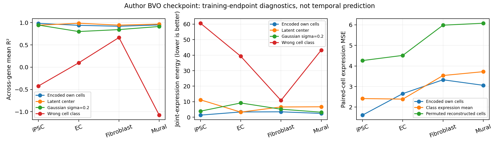
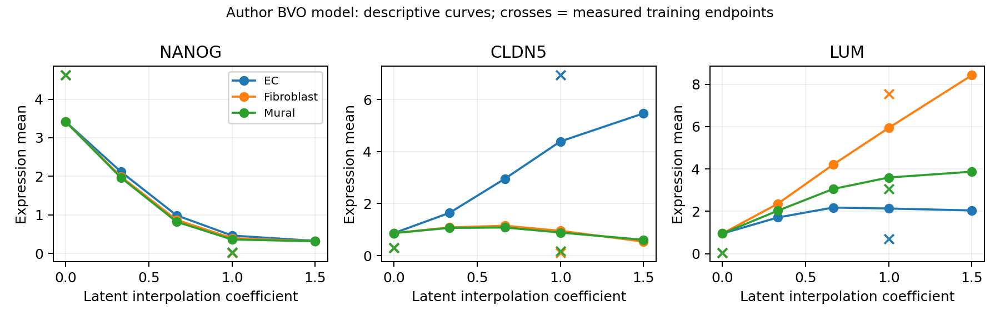
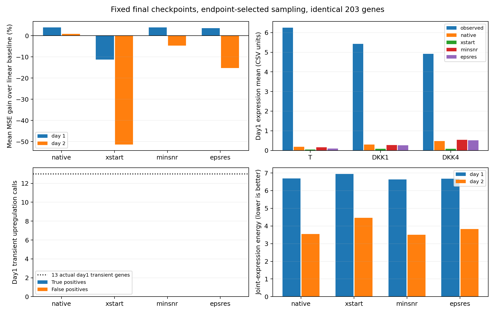

# Squidiff 第三轮：作者权重核验、反向采样修复与训练对照

完成日期：2026-11-15（北京时间）。新增三个版本，各从头训练 100000 次更新，共 **30 万次**；训练于 14:40 完成，三个模型的完整 1000 步正式评估于 14:45 完成，补充诊断和制品核验于 14:46 完成。53 份预测文件已保存，GPU 已释放。

**结论：作者公开权重确实具有条件生成能力，部分 BVO 定性标记变化可以产生；但 Fig.2 真实未见瞬态的强预测结论仍未在当前公开协议检验中获得支持。** 本轮确认并修复 x₀ 输出与反向采样的含义冲突，修正作者 notebook 的数据接口后验证配套权重，完成三种优化/结构对照。工程修复是真实的；新增版本仍未恢复 day1 T/DKK 的实际幅度，不能以高整体相关性或弱曲线隆起宣布生物学复现成功。

在同一 203 基因、同细胞、同训练预算及独立端点选参下，xstart/minsnr/epsres 的 day1 R² 为 **0.5873/0.6436/0.6423**，线性基线为 0.6291；T 均值为 **0.0469/0.1604/0.0969**，真实为 **6.2501**。三个正式选择方案的 day1 瞬态恢复均为 **0/13**。Min-SNR 和残差 ε 相对线性基线保留约 3.9%/3.5% 的均值 MSE 收益，与已有 native 的有限收益接近；三个新版本的 day2 均值误差均高于线性基线，没有得到一致改进。失败与退步结果全部列在后文。

## 任务、已有进度与证据边界

已阅读 `report.md`、`report-2.md`、本地公开作者稿正文、补充材料，以及训练、模型、扩散、数据准备和采样代码；重新在线读取 [issue #8](https://github.com/siyuh/Squidiff/issues/8) 全部讨论及[作者复现仓库 README](https://github.com/siyuh/Squidiff_reproducibility)。历史两轮已覆盖原生 TrainLoop、表达尺度、HVG 对数底、标准化裁剪、潜变量分布/配对、训练种子和正负对照。主要缺口是作者制品的直接验证。本轮新增工作与历史结果分开保存。

作者在 2026-03-21 的 issue 回复称发布 Fig.2 数据准备和 checkpoint；但当前用户提供的 `/home/whs/squidiff-ckpt/27948633.zip` 成员清单与解包目录均只有 `VO_diff_model.pt`，没有 `fig2_model.pt`。VO 权重输入/输出均为 596 维，配套 `VO_trained_adata.h5ad` 为 6838×596；Fig.2 notebook 要求 203 维，不能混用。BVO 配套数据包含 iPSC、EC、Fibroblast、Mural 四组端点，没有真实中间时间点。因此先检验作者模型的条件生成和负对照，将训练细胞重建与未见日龄预测分别评价。

论文的整体表达相关性、细胞联合分布、未见瞬态程序和非加性交互是不同主张。本轮不以一个高 Pearson 或漂亮轨迹判断整篇论文可靠，也不从一个任务的阴性结果推断其他实验无效。

## 如何解释这轮结果

**公开权重可用，与预测时间真实，是两个需要分别验证的问题。** VO 训练细胞自身编码生成的均值 R² 为 0.918–0.983，错误细胞类别编码明显降低分数，说明语义条件确实起作用。300 个与配套训练矩阵不重合的 iPSC day0 细胞也能条件生成。但类别均值基线的跨基因 R² 接近 1，真实 RNA 被提供给编码器，且部分逐细胞误差和异质性仍不理想；这些结果支持条件生成的可用性，不能单独支持未见日龄的正确预测。VO 权重本身只含 state_dict，原始随机种子、完整超参数和环境没有绑定在文件中；本轮按配套 notebook 的当前默认网络、1000 步线性扩散与原 ε 公式运行，并非重训出作者原始训练过程。

**三个新版本没有把训练目标调整转化为真正的瞬态恢复。** xstart 修复后训练 loss 很低，但独立端点验证 loss 从 10k 的 1.483 升至 100k 的 1.844；Min-SNR 从 0.271 升至 0.482，epsres 从 0.772 升至 2.449。各目标单位不同，不能横比 loss 大小；各自内部的训练/验证分离提示过拟合。固定最终权重的直接 x₀ 版本反而退步，Min-SNR 和输入残差主要维持已有的小幅 day1 均值收益，day2 均值预测退步。因此不能把原失败简单归因于默认优化器、单一输出目标或缺少一条输入恒等路径。

**模型确实利用了方向，但方向没有恢复真实中间程序。** 严格保留同一残差分布和 xT，只减去均值方向后，xstart/minsnr/epsres 的 day1 R² 从 0.5873/0.6436/0.6423 降至 0.5824/0.6069/0.6168。不能据本轮失败说方向完全无用。另一方面，给模型编码真实 day1 RNA 的 oracle 诊断，R² 可到 0.714/0.813/0.793，T 仍只有 0.405/0.476/0.170，远低于 6.250。这里从随机 xT 生成，没有保留目标完整随机编码，不是可逆重建；它显示未见状态的编码/条件生成本身也不充分，失败不能全归结为插值直线选错。

**均值的小收益没有对应到更好的真实细胞状态。** 三个新版本 day1 的联合 energy 为 6.947/6.630/6.683，均高于简单端点混合基线的 5.850；day2 同样高于该基线。day1 的 13 个真实瞬态上调基因贡献约 54%–58% 的均值平方误差，T/DKK1/DKK4 合计贡献约 41%–43%，因此不只是一个 T 指标的偶然失败。Min-SNR 固定 σ=0.7 可得到 4 个真阳性，却同时产生 32 个假阳性，day1 均值 MSE 比线性基线高约 49%；它不构成瞬态救援。

**更符合证据的解释是端点信息、表示与推理分布共同限制了结果。** 语义编码没有固定高斯先验，端点经验残差校准确实比固定 σ 更稳；但端点重建和经验分布插值并不提供中间日特异程序的约束。许多不同曲线都可穿过相同端点，例如 `μ(α)=(1−α)μ0+αμ3+c·α(1−α)`；端点损失不能确定真实 c。这解释了为什么修好采样含义、改变损失和稳定输入路径，仍可能没有获得真实 T/DKK 峰。它是对当前任务的可识别性分析，不是所有端点方法必然失败的证明。

本轮的停止范围也据此限定：三个新版本各只有一个训练种子，未穷举超参数、早停和其他轨迹模型；source 训练含 2400 行、2237 个唯一细胞，验证 400 个端点细胞与训练 ID 无重合，测试端点仍有 163 个训练 ID 重合，中间日没有训练 ID 重合。HVG 发现沿用四天数据，当前中间日已被多轮分析过，也没有供体/批次隔离。因此这是公开协议的复现和开发诊断，不能作为新方法的独立最终确认试验。若继续研究，应明确增加可检验的真实轨迹信息或先验，并在独立供体/批次上验证；现有数据上继续扫描种子或噪声不等于独立验证。

## 新发现和冻结方案

上游 `diffusion.py` 的 `training_losses` 根据 `model_mean_type` 选择 x₀ 或 ε 目标，但 `p_mean_variance` 无条件按 ε 解码；`predict_xstart=True` 会产生训练/推理含义冲突。默认 ε 路径不受此问题影响，此项不能解释历史默认模型的失败。修复放在本地适配模块，保留上游快照及其哈希；用已知解析输出检验 x₀ 语义，并检查默认 ε 路径数值一致。

新增训练均为明确的方法对照：直接预测 x₀、Min-SNR ε 损失、带输入恒等残差的 ε 网络。三者固定 source 203 基因、2400 行 day0/day3 训练数据、seed42、100000 更新、batch64、1000 扩散步、lr=1e-4 线性衰减；不使用中间日选择模型、训练终点或采样参数。它们不等于原论文默认模型。历史 round2 native 100k 作为同细胞同面板基线。所有中间日已经在历史多轮分析中被查看，只能作为复现/开发诊断集。

评价固定最终权重，以独立端点验证选择潜变量分布，报告全 1000 DDIM 步结果、简单端点基线、T/DKK 等幅度、瞬态 TP/FP 及联合分布。训练改动不额外提供真实时间轨迹信息。源协议的端点重复抽样、端点 train/test ID 重合和跨日 HVG 发现限制沿用并明确记录。

## 磁盘管理

开始时共享文件系统总量约 100GB，已用约 84GB，剩余约 17GB。作者提供目录约 22GB（含约 11.3GB 下载包及已解包数据）；本轮不重复解包，也不删除作者制品。仅在核验后清理已完成旧实验的冗余 checkpoint，保存路径、大小、哈希和保留依据。数据、预测、日志和主权重保留。

已删除 `results/ipsc/v1/previous.pt` 与 `results/norman/v1/previous.pt`，合计 1,669,118,116 字节（约 1.55GiB）。先确认 latest 均为 100000 更新且模型参数/缓冲区与保留的 `step_100000.pt` 完全一致，再删除较旧的 previous 优化器快照。`latest.pt`、best 和最终权重仍在。清单和删除前 SHA256 见 `logs/round3/checkpoint_cleanup.json`。

另核验了 round2/round3 已完成运行中的 15 对快照，SHA256 完全一致后将重复路径替换为硬链接，保留全部路径、文件内容和校验值，释放 2,935,114,340 字节。仅处理 status=trained、100000 更新的运行，训练中的文件不处理。与上面的旧快照清理合计回收 **4,604,232,456 字节（约 4.29GiB）**，见 `logs/round3/exact_checkpoint_dedup.json`；后续原子保存会替换单一路径，当前已完成快照保持只读使用。

## 具体代码不足、修复与可检验假设

| 项目 | 证据与含义 | 本轮处理 | 是否能解释原默认 ε 复现失败 |
| --- | --- | --- | --- |
| x₀ 输出含义冲突 | 上游训练按 START_X 生成表达目标，采样却调用 `_predict_xstart_from_eps` | `scripts/diffusion_adapter.py` 为 START_X 实现独立分支；训练和 DDIM 都使用同一种输出含义 | 不能，默认 ε 没有走该错误分支 |
| 原作者制品接入缺失 | 过去只检查 VO 维数不匹配 Fig.2，没有跑配套 596 维数据；新目录提供完整配套数据 | 严格加载权重、逐基因顺序核对、原数据值核对，增加正确/错误语义条件和未见细胞诊断 | 补足验证缺口，不能补出不存在的 Fig.2 权重 |
| BVO notebook 数据对象接口错位 | cell54 的 `sc.read_h5ad` 返回 AnnData；cell56 的 `data[0]` 实际是 1×596 的首个 EC 细胞；cell57 却指定生成 6838 行，语义条件会广播；后续首细胞内的 iPSC 子集为空 | 本地核验入口始终对整份 AnnData 编码/分组，避免把数据集包装器接口套在 AnnData 上 | 这是公开入口问题；不能据此判定作者实际训练运行使用了错误对象 |
| Fig.2 相邻预处理 notebook 路径不一致 | 前一份写 `val_adata_raw.h5ad`/`test_adata_raw.h5ad`，后一份读 `datasets/diff_val_raw.h5ad`/`datasets/diff_test_raw.h5ad` | 本地入口显式指定并验证训练/验证/测试文件，生成代码导出和接口审计 | 需要人工修正才能串行运行；不是低预测质量的充分解释 |
| ε 损失与表达误差尺度不一致 | 对固定 t，`MSE(ε)=SNR(t)·MSE(x₀)`；高噪声端 ε 的小误差可被放大成表达大误差 | xstart 直接以表达目标训练；minsnr 使用 `min(SNR,5)/SNR` 加权 ε 损失 | 是待检验的优化假设，不是已经证实的主要原因 |
| 输出网络缺少输入恒等路径 | 当前公开 `MLPModel` 连续经过三层块后直接输出；补图提到 residual，但实际 forward 没有块间输入残差 | epsres 使用已在 Norman 试过的显式 `ε=x_t+MLP(x_t,t,z)` 和零输出初始化，在 iPSC 同面板重训 | 是明确的结构扩展，不能称恢复作者隐藏实现 |
| 潜变量采样分布与编码分布不一致 | 编码器没有固定高斯先验；同一作者权重上 σ=0.2、中心、自身编码的结果明显不同 | 延用独立端点校准；固定 σ 结果同时保留，不能只报较优方案 | 可影响整体生成，但不足以提供真实中间态信息 |
| 跨基因均值评分不检验细胞状态 | 作者权重的类别均值基线 R² 接近 1，打乱生成行不改变该分数 | 同时报逐基因 W、联合 energy、方差、真实瞬态幅度；配对 MSE 只用在真正有配对的条件生成中 | 是评估不足，不能通过修复评分创造生物学预测能力 |

Min-SNR 是明确引入的既有扩散优化策略，依据 [Hang 等，ICCV 2023 原论文](https://openaccess.thecvf.com/content/ICCV2023/html/Hang_Efficient_Diffusion_Training_via_Min-SNR_Weighting_Strategy_ICCV_2023_paper.html)，不是 Squidiff 默认设置。三个新版本都没有增加实际日龄条件或中间态训练信息。不同目标下的训练/验证 loss 单位不同，不能按 loss 绝对值跨版本排序。

数值检验见 `results/round3/adapter_audit.json`：在 100/1000 步时间网格上，用完美 x₀ 模型构造已知答案，原采样器最大 x₀ 误差为 160.319/175.514；修复后的 x₀、后验均值和完整 DDIM 最终样本误差均为 0。实际模型时间步映射也通过检查。默认 ε 的方法绑定与全部均值/方差输出保持不变，完整 100 步 DDIM 逐位一致；Min-SNR ε/表达误差等价式最大数值差为 7.45e-9。

修复保留 Squidiff 对非负表达的下界和固定方差约定，不把标准化后的 0 当成物理表达零。上轮 z-score 裁剪修复和其他实验结果全部保留，本轮未再次改动。上游快照不修改；默认 ε 的兼容性不是靠重新实现后近似比较来声称。

上述 notebook 问题由 `scripts/round3_notebook_audit.py` 以实际配套 AnnData 和固定代码单元检查，结果见 `results/round3/notebook_audit.json`。因此本轮是使用作者原权重、原模型和原 ε 反向公式，在修正了数据接口的本地入口运行，并非声称作者 BVO notebook 原样从头到尾执行成功。Fig.2 推理 notebook 还在加载一次权重后循环生成 6 次，这属于采样重复；不能据此把 6 次输出称为 6 次独立训练，训练不确定性需要另做训练重复。

## 运行结果

作者原权重的结果见下节；同面板正式训练和补充条件诊断由运行输出生成，完整表保留固定 σ 与端点校准两种结果。


<!-- AUTHOR_RESULTS_START -->

## 作者原始权重的直接结果

每组固定随机抽取 300 个配套训练细胞，seed1000，完整 1000 DDIM 步。四种语义方式共享初始 xT；没有按结果选择采样。`encoded` 输入自身真实 RNA 的编码；错误条件来自另一真实细胞类型。高斯中心采用作者 BVO notebook 的 σ=0.2。

| 组 | 自身编码 Pearson | 自身编码 R² | 错误类别 R² | 高斯中心 R² | 无噪声中心 R² | 类别均值 R² |
| --- | --- | --- | --- | --- | --- | --- |
| iPSC | 0.9959 | 0.9832 | -0.4227 | 0.9451 | 0.9421 | 0.9981 |
| EC | 0.9825 | 0.9397 | 0.0971 | 0.8000 | 0.9862 | 0.9987 |
| Fibroblast | 0.9762 | 0.9181 | 0.6654 | 0.8434 | 0.9434 | 0.9975 |
| Mural | 0.9923 | 0.9479 | -1.0764 | 0.9132 | 0.9674 | 0.9953 |

类别均值使用全部该类配套训练细胞，只作本实验容易程度的对照；它没有生成真实细胞异质性。下面的配对误差只有在输入同一真实细胞 RNA 的条件生成时才有定义，不能搬用到没有配对关系的中间日预测。

| 组 | 自身编码配对 MSE | 类别均值配对 MSE | 生成/真实总逐基因方差 |
| --- | --- | --- | --- |
| iPSC | 1.6111 | 2.4157 | 0.7491 |
| EC | 2.6558 | 2.3890 | 0.7696 |
| Fibroblast | 3.3283 | 3.5361 | 0.6305 |
| Mural | 3.0597 | 3.7228 | 0.6003 |

把生成行顺序打乱，均值 R² 完全不变，配对 MSE 却从 1.61–3.33 升到 4.26–6.08。模型确实保留了一部分细胞信息；EC 的自身编码配对误差还高于类别均值基线，生成方差普遍缩小至真实的约 60%–77%。语义中心在部分均值指标上更高，却可能丢失异质性，不能仅据均值分数挑选。



提供的权重两个 BN 计数均为 500000，与 BVO notebook 的更新次数相符；6838 个训练细胞中，1000 个来自 iPSC day0，5838 个为 BVO Control，含 1468 EC、952 Fibroblast、3418 Mural。后者已经覆盖 `adata_norm.h5ad` 中全部非 HSC-like Control 细胞，逐值误差为 0，因此该文件不再提供独立的 Control 测试细胞。按 0、1/3、2/3、1、1.5 生成的三谱系曲线保存在 `descriptive_curves.csv` 及 NPZ，只有描述意义，没有真实中间日作为检验。曲线统一采用随机 xT 和 σ=0.2，α=0 也采用同一规则；α=1.5 属于外推。各系数采用一致采样规则，便于解释曲线形状。

596 基因名单中有 NANOG、GATA6、CLDN5、SOX17、LUM 等，但没有 T 或 TBXT，也没有 PECAM1、PDGFRB；指标和曲线仅涵盖模型实际输出的基因，标记覆盖清单见 `author/marker_coverage.json`。因此这份权重不具备 Fig.2 T 的输出坐标。

作者权重可以生成部分与 Fig.4 描述方向相近的定性变化：EC 路径 α=0→1 的 NANOG 从 3.416 降至 0.462，CLDN5 从 0.864 升至 4.393；LUM 为 0.951→1.710→2.180→2.134，存在较弱的中间隆起。它支持某些定性图形可以由作者权重产生，但缺少对应真实时间序列，不能据此确认隆起幅度或发生时间准确。



另外从原始 iPSC 缓存抽取了与配套训练矩阵无 ID 重合的 300 个 day0 细胞，596 基因全部可对齐，作者 1000 个 iPSC 训练细胞与缓存逐值误差也为 0。未见细胞自身编码条件生成 Pearson=0.9934、R²=0.9729、配对 MSE=2.5070；训练 iPSC 均值基线配对 MSE=2.3173。这是细胞分离的端点生成诊断，目标 RNA 仍被提供给编码器，没有供体隔离，也不是未见日龄预测。

这组证据支持“公开作者权重具有条件生成能力”，但不验证 Fig.2 的纯端点瞬态预测或 BVO 插值时间的真实性。当前制品无法把后两项结论逐点重放。


<!-- AUTHOR_RESULTS_END -->

## 复算入口与证据保存

环境为本机 A100 40GB、Python 3.10.22、PyTorch 2.5.1+cu121、Scanpy 1.10.4、AnnData 0.10.9；见 `docs/round3/environment.json` 和 `requirements-freeze.txt`。实际解释器为 `/home/whs/mydata/conda-env/squidiff/bin/python`。训练保留 IEEE FP32，使用私有 MPS 目录共享同一张 GPU；这只是调度，不改变模型目标或混合训练样本。

关键代码均来自当前公开主分支，Fig.2 数据准备/推理、BVO notebook 和 `diffusion.py` 的 Git blob SHA1 与本地快照相同，见 `docs/round3/live_source_refs.json`。复现仓库各 notebook 的代码单元另行导出到 `docs/round3/*.py.txt`，便于检查路径和数据接口。作者文件 MD5 与 Figshare v3 清单一致；外层 ZIP 与三个 KS 数据 ZIP 的成员清单保存到 `results/round3/author/`，均没有隐藏的 Fig.2 checkpoint。未重复下载多 GB 数据。

在原机器相同目录下，核心命令为：

```bash
conda activate /home/whs/mydata/conda-env/squidiff
python scripts/author_checkpoint_audit.py inventory
python scripts/author_checkpoint_audit.py evaluate --steps 1000 --cells 300
python scripts/round3_author_unseen.py
python scripts/round3_notebook_audit.py
python scripts/round3_adapter_audit.py
python scripts/round3.py train --variant xstart
python scripts/round3.py train --variant minsnr
python scripts/round3.py train --variant epsres
python scripts/round3.py evaluate --variant xstart --sample-steps 1000 --cells 600
python scripts/round3.py evaluate --variant minsnr --sample-steps 1000 --cells 600
python scripts/round3.py evaluate --variant epsres --sample-steps 1000 --cells 600
python scripts/round3_diagnostics.py
python scripts/round3_integrity.py
python scripts/round3_prediction_summary.py
python scripts/round3_report.py
```

已有训练目录受到覆盖保护；从头重跑应使用另一个 `--seed`，在同一源码/配置下对同一目录完整续训用 `--resume`。主报告表冻结为 seed42，不能在更换种子后仍称重跑该张表。`round3_queue.py` 是本次私有调度入口，等待作者检查完成后启动三个训练，检查退出码，再依次正式评估；阶段完成标记和进程记录在 `logs/round3/`。

本轮主文件：

- `results/round3/author/inventory.json`、`notebook_audit.json`：制品身份、基因顺序、数据对齐及公开入口问题。
- `results/round3/author/eval_1000/`：16 份作者端点预测、15 份描述性插值预测、逐基因表、基线与负对照、复算哈希。
- `results/round3/author/unseen_ipsc/`：300 个未见细胞的预测、原值、ID 和指标。
- `results/round3/{xstart,minsnr,epsres}_s42/`：配置、逐千步训练记录、独立端点验证、完整续训状态、早期/最终权重；`eval_final_1000/` 中保留候选选择依据、NPZ 和逐基因表。
- `results/round3/adapter_audit.json`、`protocol.json`、`final_integrity.json`：反向目标、数据协议和最终一致性核验。
- `results/round3/selected_metrics.csv`、`marker_means.csv`、`error_decomposition.csv`：最终同面板对照与标记/瞬态误差。

训练/验证 loss 数值属于各自目标，不作跨目标优劣排名；去噪 loss、从真实 RNA 编码后生成和只由端点预测中间日也分别记录。论文的其他药物、辐射、G-CSF 实验没有因本轮作者 VO 检查而自动获得验证。


<!-- TRAINING_RESULTS_START -->

## 同面板的新增训练与正式预测

均为 203 基因、相同训练/验证/测试细胞、seed42、固定最终 100000 更新、1000 DDIM 步、600 生成细胞。native 来自第二轮，是历史基线，不计为本轮新增训练。每个新版本只有一次独立训练，采样不是训练重复。`fixed` 固定 σ=0.7；`selected` 仅按独立端点 Wasserstein 选择潜变量方案。

| 版本 | 日 | 采样 | Pearson | R² | 反向 R² | 线性 R² | MSE 改善% | T 均值 | T>3 比例 | 瞬态 TP/FP | 联合 energy |
| --- | --- | --- | --- | --- | --- | --- | --- | --- | --- | --- | --- |
| native | 1 | fixed | 0.7440 | 0.3488 | 0.0561 | 0.6291 | -75.5912 | 0.8980 | 0.0617 | 4/53 | 9.0694 |
| native | 2 | fixed | 0.8811 | 0.3696 | 0.3183 | 0.7480 | -150.1212 | 0.9376 | 0.0683 | 2/71 | 6.6676 |
| native | 1 | selected | 0.8093 | 0.6435 | 0.5709 | 0.6291 | 3.8774 | 0.1824 | 0.0000 | 0/0 | 6.6934 |
| native | 2 | selected | 0.8888 | 0.7500 | 0.7342 | 0.7480 | 0.7943 | 0.3117 | 0.0017 | 0/0 | 3.5430 |
| xstart | 1 | fixed | 0.7958 | 0.5794 | 0.5946 | 0.6291 | -13.3976 | 0.1493 | 0.0000 | 0/0 | 10.3726 |
| xstart | 2 | fixed | 0.8199 | 0.5875 | 0.6155 | 0.7480 | -63.6757 | 0.1998 | 0.0000 | 0/0 | 7.6874 |
| xstart | 1 | selected | 0.7932 | 0.5873 | 0.5853 | 0.6291 | -11.2663 | 0.0469 | 0.0000 | 0/0 | 6.9469 |
| xstart | 2 | selected | 0.8592 | 0.6185 | 0.6869 | 0.7480 | -51.3931 | 0.2412 | 0.0300 | 0/0 | 4.4582 |
| minsnr | 1 | fixed | 0.7410 | 0.4485 | 0.1092 | 0.6291 | -48.6948 | 0.8547 | 0.0517 | 4/32 | 7.9007 |
| minsnr | 2 | fixed | 0.8832 | 0.5723 | 0.4825 | 0.7480 | -69.6999 | 0.8791 | 0.0617 | 2/36 | 4.6674 |
| minsnr | 1 | selected | 0.8094 | 0.6436 | 0.5717 | 0.6291 | 3.8950 | 0.1604 | 0.0000 | 0/0 | 6.6303 |
| minsnr | 2 | selected | 0.8856 | 0.7360 | 0.7315 | 0.7480 | -4.7606 | 0.2988 | 0.0083 | 0/0 | 3.5020 |
| epsres | 1 | fixed | 0.8007 | 0.6385 | 0.4736 | 0.6291 | 2.5161 | 0.1136 | 0.0000 | 0/0 | 10.7609 |
| epsres | 2 | fixed | 0.8610 | 0.7383 | 0.6757 | 0.7480 | -3.8519 | 0.1237 | 0.0000 | 0/0 | 8.0291 |
| epsres | 1 | selected | 0.8094 | 0.6423 | 0.5781 | 0.6291 | 3.5451 | 0.0969 | 0.0000 | 0/0 | 6.6830 |
| epsres | 2 | selected | 0.8785 | 0.7095 | 0.7216 | 0.7480 | -15.2733 | 0.2296 | 0.0017 | 0/0 | 3.8320 |

所有结果包含失败和退步版本。真实 day1 T 均值为 6.2501，13 个基因的真实均值超过训练端点最大均值 0.5；day2 依相同规则单独评价。MSE 改善为相对同面板线性表达均值插值的误差下降，负数表示退步。energy 是含对角线的有限样本 V 统计量，越低越好。

实际端点选择：

| 版本 | 方式 | σ/系数 | 端点 W |
| --- | --- | --- | --- |
| xstart | empirical | 1.0000 | 0.4894 |
| minsnr | empirical | 1.0000 | 0.4922 |
| epsres | empirical | 1.0000 | 0.5002 |



day1 标记绝对均值（端点选择方案）：

| 基因 | 真实 | native | xstart | minsnr | epsres |
| --- | --- | --- | --- | --- | --- |
| T | 6.2501 | 0.1824 | 0.0469 | 0.1604 | 0.0969 |
| DKK1 | 5.4312 | 0.2955 | 0.0775 | 0.2785 | 0.2582 |
| DKK4 | 4.9115 | 0.4815 | 0.0878 | 0.5338 | 0.5203 |
| FST | 5.3536 | 2.1540 | 1.6454 | 2.1637 | 2.1007 |
| NANOG | 3.6641 | 3.9509 | 4.7291 | 3.9112 | 4.1335 |
| GATA6 | 2.5613 | 0.8892 | 0.0513 | 0.9703 | 0.8067 |

同一 source 面板的简单分布基线沿用第二轮已保存的 3 次抽样均值，没有新增训练：`cell_linear` 对随机端点细胞逐细胞表达插值，`endpoint_mixture` 只混合端点细胞。

| 基线 | 日 | 逐基因 W | 联合 energy |
| --- | --- | --- | --- |
| cell_linear | 1 | 0.7359 | 7.2272 |
| cell_linear | 2 | 0.6740 | 3.7863 |
| endpoint_mixture | 1 | 0.6245 | 5.8503 |
| endpoint_mixture | 2 | 0.5042 | 3.1623 |

完整端点候选结果（仅端点验证；主选择指标为 W，MSE 同时记录）：

| 版本 | 方式 | σ/系数 | 端点 W | 端点均值 MSE |
| --- | --- | --- | --- | --- |
| xstart | fixed | 0.7000 | 0.8241 | 0.7430 |
| xstart | isotropic | 0.0000 | 1.4677 | 2.8217 |
| xstart | isotropic | 0.4269 | 0.8875 | 0.9269 |
| xstart | isotropic | 0.8539 | 0.8259 | 0.7487 |
| xstart | empirical | 1.0000 | 0.4894 | 0.5477 |
| xstart | paired | 1.0000 | 0.9107 | 1.2721 |
| xstart | ot | 1.0000 | 0.5967 | 0.4584 |
| minsnr | fixed | 0.7000 | 1.0970 | 1.3122 |
| minsnr | isotropic | 0.0000 | 1.1144 | 0.4864 |
| minsnr | isotropic | 0.2002 | 0.8373 | 0.4184 |
| minsnr | isotropic | 0.4003 | 0.6872 | 0.4930 |
| minsnr | empirical | 1.0000 | 0.4922 | 0.4176 |
| minsnr | paired | 1.0000 | 0.7155 | 0.4087 |
| minsnr | ot | 1.0000 | 0.5617 | 0.4188 |
| epsres | fixed | 0.7000 | 0.9149 | 0.6289 |
| epsres | isotropic | 0.0000 | 1.2189 | 0.7691 |
| epsres | isotropic | 0.4886 | 1.0396 | 0.6794 |
| epsres | isotropic | 0.9772 | 0.7942 | 0.6291 |
| epsres | empirical | 1.0000 | 0.5002 | 0.4287 |
| epsres | paired | 1.0000 | 0.8381 | 0.7150 |
| epsres | ot | 1.0000 | 0.6499 | 0.5258 |


<!-- TRAINING_RESULTS_END -->


<!-- DIAGNOSTICS_START -->

## 固定主结果后的 day1 条件诊断

以下诊断不改变主方案或采样选择。`selected_replay` 重放已保存的主预测；`mean_direction_removed` 保留相同潜变量残差、相同初始 xT，仅减去 α·Δz 的均值方向；`target_rna_oracle` 将真实 day1 RNA 提供给编码器，仅检查未见状态的条件生成能力。它不是预测成绩。

| 版本 | 诊断 | R² | T 均值 | 瞬态 TP/FP | 联合 energy |
| --- | --- | --- | --- | --- | --- |
| xstart | selected_replay | 0.5873 | 0.0469 | 0/0 | 6.9469 |
| xstart | mean_direction_removed | 0.5824 | 0.0445 | 0/0 | 7.0330 |
| xstart | target_rna_oracle | 0.7140 | 0.4053 | 4/8 | 7.5061 |
| minsnr | selected_replay | 0.6436 | 0.1604 | 0/0 | 6.6303 |
| minsnr | mean_direction_removed | 0.6069 | 0.1403 | 0/0 | 7.2056 |
| minsnr | target_rna_oracle | 0.8129 | 0.4760 | 4/2 | 5.0342 |
| epsres | selected_replay | 0.6423 | 0.0969 | 0/0 | 6.6830 |
| epsres | mean_direction_removed | 0.6168 | 0.0890 | 0/0 | 7.2139 |
| epsres | target_rna_oracle | 0.7934 | 0.1703 | 4/0 | 6.3375 |

与保存的主预测重放最大差：xstart=0, minsnr=0, epsres=0。


<!-- DIAGNOSTICS_END -->

## 完成与校验

三个正式状态均为 trained、100000 更新；最终权重全部有限，两个编码器 BN 层各记录 100000 次训练更新。模型配置记录 52,142,343 个参数、同一训练矩阵 SHA256、目标类型、损失权重、模型变体和运行源码哈希。默认 ε 兼容性及 x₀ 解析测试通过；三个主预测在补充诊断中的重放最大差均为 0。

`results/round3/final_integrity.json` 保存 53 份 NPZ 的形状与 SHA256，检查全部基因顺序和有限值，重新计算正式预测及补充诊断的主要指标；作者端点预测另由 `author/eval_1000/integrity.json` 独立复算。作者原权重未变，历史归档 1029 个文件的 SHA256 全部未变。最终汇总没有改写原预测。源码清单及核心训练源码副本保存在 `docs/round3/source_manifest.json` 和 `docs/round3/training_sources/`，本轮交付清单见 `results/round3/delivery_manifest.json`。

训练/评估子进程的退出码均通过调度器检查，完成记录见 `logs/round3/training_complete.json`、`queue_complete.json`；独立的补充诊断、复算和汇总会话退出码为 0，见 `finalization_complete.json`。另一个运行层面的异常需保留：回收外层 GPU 调度工具会话时返回 **143（SIGTERM）**，原因未从日志定位；其日志没有异常栈，三个训练、三个评估的完成标记以及 MPS 关闭记录均已写出，全部制品通过了后续独立核验。因此不将该外层会话称为正常退出，也不据它否认已完成并核实的训练；原始状态见 `logs/round3/session_exit_audit.json`。

私有 MPS 已关闭，最终 GPU 检查为 0MiB、0% 利用率，无本轮训练/评估进程残留。共享文件系统约余 16GiB；作者提供的目录、原始数据、预测、日志和主模型均保留。15 对完全相同快照共享存储，另删除两份过时 previous 快照，总计回收约 4.60GB。
