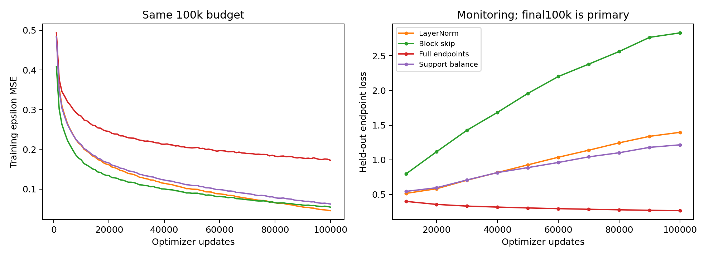
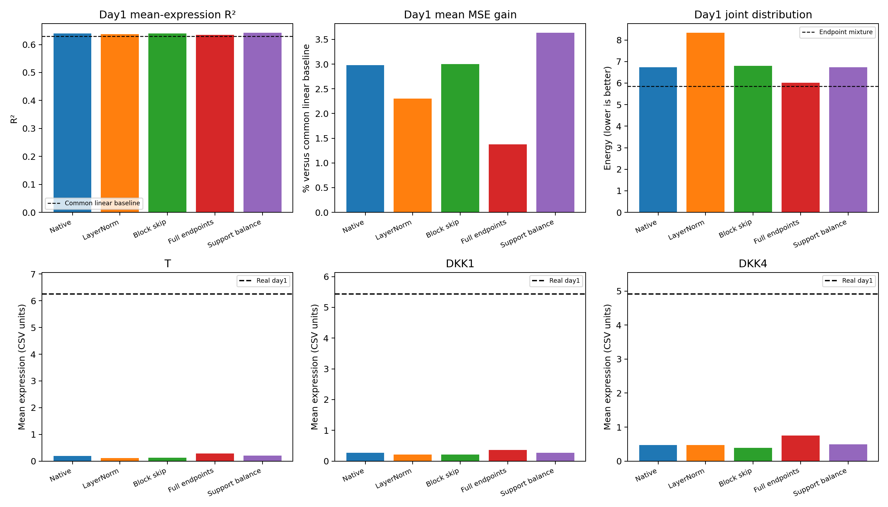
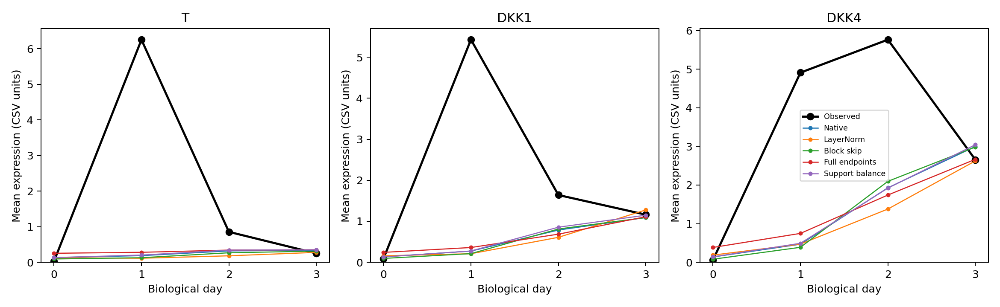

# Squidiff 第四轮：完整 issue 审阅与 day1 最后受控尝试

完成日期：2026-11-15（北京时间）。四个新版本均从头完成100000次更新，共 **40万次正式更新**；训练于20:03完成，完整链评估、容量诊断及独立数值核验于20:13完成，随后审阅图表并整理结论。全部训练、评估与汇总进程正常退出，GPU已释放。

**结论：真实day1瞬态状态仍未复现，建议在这里结束当前公开协议复现路线。** 四版主方案的day1 R²为0.6342–0.6426，仅比共同线性基线减少约1.4%–3.6%的均值误差；T均值仅0.113–0.280，真实为6.250，瞬态恢复均为0/13。已知训练端点的条件重建、较高整体相关性和弱曲线隆起可以得到，但本轮未找到将它们转化为真实day1预测的修复。这个结论是现有公开数据、协议和制品下的实证判断，不是数学上排除所有可能设置。

本轮的具体问题是：只用 day0/day3 训练，能否恢复真实 day1 的 T/DKK 瞬态状态，而不只是得到较高的整体表达相关性或一条视觉上平滑的轨迹？不搜索训练种子，不按 day1 分数选择采样、基因面板或训练终点。所有新增训练固定 seed42、100000 次优化更新。共同随机输入仅用于成对比较，不作为找原因或挑成绩的手段。

## 1．阅读范围与前三轮进度

已重新阅读 [论文](https://www.nature.com/articles/s41592-025-02877-y)的本地公开作者稿全文、[补充图与超参数](docs/supplement.pdf)、早期完整预印本的方法、作者两个仓库的 Fig.2 预处理/训练/推理代码，以及 `report.md`、`report-2.md`、`report-3.md` 和关键审计脚本。本轮另成功获取并补读 [2025-08-26修订预印本的完整Methods](https://doi.org/10.1101/2024.11.16.623974)，原始XML及提取文本在 `docs/round4/updated_preprint.*`。它明确写lr=1e-4、203基因、端点共2400训练细胞，修正了早期稿500基因/lr=1e-3的表述，符合当前公开代码。出版网页公开部分不包含完整Methods；公开作者稿的Supplementary Methods下载未成功，不能冒称已读到该附件。尝试记录见 [methods_download_audit.json](docs/round4/methods_download_audit.json)。MOESM2实际是Reporting Summary，已经逐页查看，不能当作Methods。补充图已逐图核对，特别区分图注所称residual和代码中的条件投影相加。

前三轮已经完成：默认模型多次从头训练、原生 TrainLoop 的 100k 长程对照、IEEE FP32、表达尺度/HVG/scaling、经验条件分布与端点运输、保留随机编码、早停/小网络、x₀ 目标修正、Min-SNR、ε 输入残差和作者 BVO 权重核验。因此本轮不会再把这些事项当作未做过的新建议。

共同 source203 面板上，历史原生模型经端点校准的 day1 R²≈0.6435，线性基线≈0.6291；T≈0.1824，真实≈6.2501；13 个真实瞬态基因恢复 0 个。原论文图示整体分数、弱 T 富集和准确恢复真实瞬态幅度是三个不同标准。原作者对应 Fig.2 的确切权重/基因名单/细胞分区仍缺失；已有 VO 权重为 596 维 BVO 模型，且不输出 T，不能用它冒充 Fig.2 模型。

在线核对两仓库当前提交仍为 `abdfc27d84947dcccd745d1067c0840a41d32eb8` 与 `7ce6d0291ee489d1fd89dda5abe8d4f993450d6e`；原始快照不改动。来源见 [live_sources.json](docs/round4/live_sources.json)。

Figshare实时核对仍为v3，仅有VO相关权重，没有匹配203维Fig.2的模型，见 [figshare_live.json](docs/round4/figshare_live.json)。另补查论文正式Source Data压缩包MOESM5：初次32MiB读取上限未完整保存，随后通过HTTP Range仅读取ZIP中央目录，确认其中只有0/1/4Gy显微图像及系统目录文件，没有Fig.2 RNA、基因表或权重。完整成员表、字节位置与CRC在 [publication_source_data_audit.json](docs/round4/publication_source_data_audit.json)；未保留伪造或不完整ZIP，也未为此占用整包约36.7MB空间。

## 2．按编号逐条阅读上游全部讨论

2026-11-15 在线读取所有状态的完整列表，按 #1→#16 依次读取正文及全部 **23 条评论**。其中 **15 个是真正的 issue，#13 是未合并的 PR**。没有把已关闭项当作已解决或复现成功的证据。完整原文快照在 [issues_index.json](docs/round4/issues_index.json)、[issues_comments.json](docs/round4/issues_comments.json)。

| 编号与链接 | 讨论内容及回复 | 对本轮的实际影响 |
|---|---|---|
| [#1](https://github.com/siyuh/Squidiff/issues/1) | 训练入口公开请求；作者承诺补代码 | 当前已有入口，但不提供原 day1 运行制品 |
| [#2](https://github.com/siyuh/Squidiff/issues/2) | 安装及使用指导请求；作者承诺完善 | 检查当前入口和参数实际行为，不推定说明文档完整 |
| [#3](https://github.com/siyuh/Squidiff/issues/3) | 药物预测需要何种条件；作者确认结构信息与控制组转录组都需要 | 不将未知目标 RNA 输入编码器算作预测；药物分支不用于此 iPSC 任务 |
| [#4](https://github.com/siyuh/Squidiff/issues/4) | 编码目标 RNA 是否泄漏；作者区分重建与潜空间操纵 | 真实 day1 编码仅列 oracle 诊断，不能列主成绩 |
| [#5](https://github.com/siyuh/Squidiff/issues/5) | 请求权重；作者指向 Figshare，并限定相关数据适用性 | 不跨维度或跨任务套用 BVO 权重 |
| [#6](https://github.com/siyuh/Squidiff/issues/6) | checkpoint 与通用预训练；作者说明不是基础模型、需针对数据训练 | 本轮继续从头训练，不能期待 VO 权重零样本解决 Fig.2 |
| [#7](https://github.com/siyuh/Squidiff/issues/7) | BVO 轨迹平坦、注释和预处理疑问；作者补 notebook/VO 权重 | 前轮已直接运行该制品；该讨论没有给出 iPSC day1 对照 |
| [#8](https://github.com/siyuh/Squidiff/issues/8) | 多人报告 Fig.2 失败；一人称去除 z-score 成功，另一人无 scaling 仍失败；作者称补制品并多次确认 | 本地未标准化原版仍失败，不能把 scaling 当充分解释；严格保留训练/推理与制品边界 |
| [#9](https://github.com/siyuh/Squidiff/issues/9) | 框架还是预训练模型；作者确认前者 | 不混淆任务内训练与通用迁移 |
| [#10](https://github.com/siyuh/Squidiff/issues/10) | 正值对数表达、负值噪声预测及生成膨胀；作者解释尺度选择并承认部分训练失败 | 检查逐步非负截断的影响；非负表达不要求 ε 非负；生成膨胀不算瞬态恢复 |
| [#11](https://github.com/siyuh/Squidiff/issues/11) | 最低细胞数；作者无硬性下限，提醒过拟合，提到约 2400/日 | 公开代码实际为 1200/端点；用同面板的全部剩余端点作样本支持度对照，明确它是扩展 |
| [#12](https://github.com/siyuh/Squidiff/issues/12) | 为什么203基因；作者说明200HVG并加入关注基因、更多基因更难 | 以可执行 notebook 为准，200HVG∪NANOG/T/GATA6；不为凑维数或提高分数更换面板 |
| [#13 PR](https://github.com/siyuh/Squidiff/pull/13) | Deployment debug，无正文，仅一条通过评论；71个改动文件，未合并 | 读取 PR 文件补丁后确认主要为部署/清理，未见经过验证的 day1 救援；不导入其工具指令或假定作者采纳 |
| [#14](https://github.com/siyuh/Squidiff/issues/14) | 请求辐射复现脚本，无回复 | 不能给 day1 提供额外证据，本轮不扩展为辐射任务 |
| [#15](https://github.com/siyuh/Squidiff/issues/15) | PRNet基因维度、预处理和公平比较疑问，无回复 | 保持同基因、同细胞与匹配基线；该问题没有提供新训练修复 |
| [#16](https://github.com/siyuh/Squidiff/issues/16) | 个人频率流形解释，无回复和实证 | 未给出可验证的训练/数据修复，不据此改模型 |

## 3．代码不足及本轮处理

**条件分布没有一致的训练约束。** 原目标是端点自身 RNA 的条件去噪；最后线性语义层没有固定高斯先验，推理的固定 σ=0.7 不具有跨模型不变尺度。前轮已验证经验条件残差能改善整体误差；本轮继续端点验证选择，同时保留固定 σ 的全部结果。

**BatchNorm使语义编码依赖同批细胞。** 原生最终权重在训练端点上，64细胞混合日龄组批相对 eval 的潜变量 RMS 差约0.126倍；同日组批约0.459倍。训练端点精确重算推理统计量后，编码只变化约0.025倍，端点去噪验证损失1.15783→1.15615，提示简单 running-stat 误差较小。它不证明 BN 是主因，但足以支持逐细胞 LayerNorm 的独立训练对照。所有 BN 校准只使用训练端点，绝不在 day1 上重估统计量。见 [BN审计](results/round4/bn_audit/complete.json)。

这项审计首个探针直接按矩阵顺序分块，曾误标为混合日龄批；由于source按日排序，其0.456倍偏移主要对应同日组批。已改成明确交错day0/day3再分块，得到上述0.126。旧探针数值及纠正原因保存在 [initial_ordered_batch_probe.json](results/round4/bn_audit/initial_ordered_batch_probe.json)；正式训练、已保存模型和BN重校准结果不受此诊断标签纠正影响。

**EMA需要对应的BN缓冲区。** 原 EMA 只平滑参数，保存函数把当前模型 BN 统计量放入 EMA state_dict；这些统计量未必适合 EMA 参数。显式分别评价 raw、训练端点重校准 raw、EMA、重校准 EMA，不以哪一个 day1 分数高来选权重。

**`clip_denoised=False`仍逐步把x₀截到零。** 这与“完全不裁剪”的接口直觉不同，也可能积累正偏置。此前只验证过标准化坐标下的下界冲突，本轮补上非负 source 数据的完整反向链消融：移除过程中的下界，仅在最终输出施加物理非负约束。它是推理协议变体，不能在结果出来之前声称一定改善。

**图注的残差说法不等于明确遗漏的块级跳连。** 补充图的块内部画了时间和语义输入相加，代码确有这一结构；代码没有通常的 `h+F(h)` 恒等跳连。新增获得的2025-08修订Methods进一步明确，其conditional residual mechanism就是向变换后的表示加入时间和语义特征。因此不能把公开网络没有恒等跳连定为论文实现错误；本轮已经冻结启动的 `resblock` 只作为结构扩展，不能声称恢复了已知作者实现。

**稀有端点状态可能被平均损失压低。** 训练端点中确有少量高T细胞，不能说高T从未出现。补充两个独立干预：同面板扩展到全部剩余端点；固定source训练细胞，对每个端点的8个无监督RNA聚类等概率抽样。后者不按T、day1标签或测试表现定义簇，属于目标分布扩展；推理仍以真实端点分布为参照。

**已知历史问题不再当本轮新发现。** x₀/ε反向含义冲突、z-score下界、原CLI字符串布尔解析、Fig.2文件名不一致、BVO `data[0]` 接口、R²参数顺序、同权重6次采样不等于6次训练，均沿用前三轮的修复/审计结论。上游快照保留原样，便于核对。

**补上可实际使用的安全训练入口。** [train_source_safe.py](scripts/train_source_safe.py)正确解析字符串False，提前拒绝维度不一致、未实现的learned variance以及未匹配反向语义的x₀开关；表达分支不再因顶层无条件导入RDKit而无法启动。原生网络、扩散及优化核心仍复用上游。首次直接导入原入口的检查确实因本机未安装RDKit失败，尚未执行训练，随后改成按需导入药物依赖；解析检查和不支持配置的拒绝检查通过。这不是新day1训练结果。反向裁剪消融的解析输出测试也通过：正值x₀时与原版最大差0，负值x₀按预期保留，见 [adapter_audit.json](results/round4/adapter_audit.json)。

原工厂还保留了部分未落实到MLP行为的配置，例如 `num_channels` 不控制这里的2048隐层，`dropout`/`use_scale_shift_norm` 也不能按接口名字推定生效。因此本轮直接修改实际模块并核对参数，而不把接受了某个命令行flag当作架构已改变的证据。这些默认值问题不解释本地已经明确构建正确网络后的day1失败。

## 4．冻结的训练与评价方案

| 新版本 | 唯一主要干预 | 训练数据 |
|---|---|---|
| layernorm | 编码器两个BatchNorm替换为LayerNorm；参数量相同 | source2400行，2237唯一细胞 |
| resblock | 去噪器三个MLP块增加 `h+F(h)` | 同上 |
| fullsource | 原网络，全部剩余端点；同203基因 | 16580唯一细胞，排除固定验证/测试全部ID |
| supportbalance | 原网络，端点内8簇等质量抽样 | 同source2400行 |

均固定：batch64、lr=1e-4线性衰减、原生AdamW更新、1000步线性扩散、ε目标、IEEE FP32、100000次更新、seed42。主权重为固定最终100k；`best.pt`仅保留监测记录，不按day1选择。全部模型参数量52,142,343。训练数据、源代码、固定方案与运行命令均保存哈希。为避免逐参数同步开销，关闭了仅用于日志的梯度/参数范数计算；`native_logs`中的范数零值是占位值，不表示实际梯度为零，真实前向/反向与参数更新另行核验。

工程预检：未改结构版本的一次完整优化更新与原网络逐参数/缓冲区最大差0；残差块代数检查最大差0；LayerNorm同一细胞换伴随细胞的编码最大差4.77e-7；四版本在真实端点任务上损失及梯度均有限。这些是工程检查，不是生物学证据，也不能当作与作者原始长期运行逐位等价的证明。见 [preflight.json](results/round4/preflight.json)。

安全入口另外通过2步真实原生优化更新的冒烟检查，保存函数在该工程检查中只记录调用，以免创建无用大checkpoint；这2步不计入四个正式版本的40万步，也没有生物学评估。记录见 [cli_smoke.json](results/round4/cli_smoke.json)。

主评价均为600生成细胞、完整1000步DDIM，七种候选仅按独立端点验证的逐基因Wasserstein选择；另完整报告固定σ=0.7。验证和正式测试各有一个预先固定的共同随机输入bank，所有模型共享，未搜索噪声种子。统一四天采样规则，另作保留完全相同day1残差和xT、只减去1/3均值方向的负对照。真实day1 RNA编码仅为oracle。

BN/EMA/截断推理消融固定采用原生模型已经选定的潜变量方案，只重新测端点质量，不重新搜索参数，以隔离单项推理改动。新增原生重放的固定σ四天预测与第二轮保存数组逐值最大差均为0，见 [native_replay_compatibility.json](results/round4/native_replay_compatibility.json)；经验采样采用本轮统一输入bank，须与本轮重放基线比较，不能把其有限抽样差异当作训练改进。

补读2025-08修订Methods后，另冻结一个字面逐细胞公式对照：`E(x0_cell)+αΔz+η`；notebook实际用 `mean(E(x0))+αΔz+η`。前轮逐细胞版本没有额外η，本轮补齐二者同时存在的情况。仍使用历史原生权重，固定σ=0.7并按端点验证在0、0.5×RMS、RMS、0.7中选择；不会按day1结果调整。原文z₀是否本意为群体代表有歧义，故列推理敏感性，不断言发现作者代码错误。协议见 [paper_inference_protocol.json](results/round4/paper_inference_protocol.json)。

实践救援门槛沿用先前 [rescue_confirmation.json](configs/rescue_confirmation.json)：至少恢复真实day1 T超出端点部分的一半、同面板均值MSE较线性基线降低至少10%，且统一采样后仍有真正中间峰。其他瞬态基因的特异性、联合分布和端点质量同时检查。这个门槛服务于本项目的停止判断，不是“所有方法成功”的普遍数学定义。

同时报告真实方向R²、反向notebook R²、相同面板精确线性基线、T/DKK绝对幅度、T>3比例、瞬态TP/FP、逐基因Wasserstein和联合energy。瞬态集合固定按历史source端点包络定义，避免更换全端点训练池时悄悄改变评价标准；fullsource另报其自身匹配线性基线。不存在生成与真实细胞逐行配对，故不使用flattened单细胞R²判定成功。

source原协议保留163个端点训练/测试ID重合；中间日没有重合，独立端点验证无训练ID重合。fullsource排除了全部验证/测试ID。source203的HVG发现接触过四天数据，且当前中间日已经过多轮查看，本轮是复现/开发诊断，不是新方法的一次独立最终测试，也没有供体隔离。新模型不能只凭比历史模型更好的单个day1分数宣布成功。

冻结方案：[frozen_protocol.json](results/round4/frozen_protocol.json)。入口：[round4.py](scripts/round4.py)、[round4_evaluate.py](scripts/round4_evaluate.py)；训练队列：[round4_queue.py](scripts/round4_queue.py)。

训练暴露的实际变化见 [endpoint_support.csv](results/round4/endpoint_support.csv)：source day3的T>3质量为3.83%，状态平衡后约5.03%；全端点day3约4.13%。但是T/DKK1/DKK4同时>3的质量分别仅0.167%、0.092%、0.260%，真实day1为49%。因此不能把状态平衡的失败解释成“已经充分强化该三基因联合程序却仍然失败”：它并没有大幅提高该联合状态的质量。该描述性比较在簇数/权重冻结后计算，没有反过来调整训练采样。

同时预先固定一项训练容量诊断：对各自训练池全部T>3的端点细胞，比较自身RNA编码与同日潜变量均值，使用主评价已固定的相同xT。它回答模型能否表达确实见过的高T端点，不能算作未见day1预测或恢复正确细胞比例；没有按生成结果挑细胞。见 [endpoint_tail_protocol.json](results/round4/endpoint_tail_protocol.json)。

## 5．磁盘处理

删除15份已完成历史训练的 `latest.pt` 优化器/RNG/EMA快照，共12,673,484,910字节（约11.8GiB）。每份均先核对训练完成状态、保存SHA256并确认其最终100k推理权重仍存在。原始数据、最终/最佳推理权重、全部预测及日志保留；保留当前原生及第三轮续训状态供本轮审计。被删除的历史运行不能从该优化器状态精确续训，这一代价明确记录。清理前可用约15.0GiB，清理后约26.8GiB。

具体清单、保留模型路径和哈希见 [checkpoint_retirement.json](logs/round4/checkpoint_retirement.json)。没有删除用户提供的作者文件或原始下载。

<!-- ROUND4_RESULTS_START -->

## 6．已完成的训练和完整链结果

新增四版均从头完成100000次更新，共400000次；原生基线与五个推理对照复用历史权重，不算新增训练。以下均为600生成细胞、1000步DDIM、固定最终权重，没有择优种子或中间日选参。

| 新版本 | 更新数 | 训练分钟 | 最低端点loss步 | 最低端点loss | 最终端点loss |
| --- | --- | --- | --- | --- | --- |
| layernorm | 100000 | 45.2894 | 10000 | 0.5167 | 1.3963 |
| resblock | 100000 | 45.4490 | 10000 | 0.7975 | 2.8289 |
| fullsource | 100000 | 45.3241 | 100000 | 0.2674 | 0.2674 |
| supportbalance | 100000 | 45.3931 | 10000 | 0.5456 | 1.2160 |



### 主比较：仅端点验证选择条件分布

| 版本 | 日 | Pearson | R² truth | R² notebook | 自身线性R² | 自身MSE改善% | 共同基线改善% | T均值 | T>3比例 | 瞬态TP/FP | 联合energy |
| --- | --- | --- | --- | --- | --- | --- | --- | --- | --- | --- | --- |
| native | 1 | 0.8086 | 0.6402 | 0.5749 | 0.6291 | 2.9778 | 2.9778 | 0.1865 | 0.0000 | 0/0 | 6.7343 |
| native | 2 | 0.8904 | 0.7529 | 0.7372 | 0.7480 | 1.9652 | 1.9652 | 0.3190 | 0.0033 | 0/0 | 3.4746 |
| layernorm | 1 | 0.8063 | 0.6377 | 0.5692 | 0.6291 | 2.3044 | 2.3044 | 0.1132 | 0.0000 | 0/0 | 8.3416 |
| layernorm | 2 | 0.8793 | 0.7531 | 0.7369 | 0.7480 | 2.0220 | 2.0220 | 0.1815 | 0.0000 | 0/0 | 4.7666 |
| resblock | 1 | 0.8100 | 0.6403 | 0.5883 | 0.6291 | 3.0036 | 3.0036 | 0.1279 | 0.0000 | 0/0 | 6.7997 |
| resblock | 2 | 0.8903 | 0.7515 | 0.7530 | 0.7480 | 1.4155 | 1.4155 | 0.2670 | 0.0067 | 0/0 | 3.5674 |
| fullsource | 1 | 0.8095 | 0.6342 | 0.5885 | 0.6286 | 1.5194 | 1.3777 | 0.2800 | 0.0217 | 0/1 | 6.0141 |
| fullsource | 2 | 0.8764 | 0.7100 | 0.7168 | 0.7424 | -12.5912 | -15.0668 | 0.3423 | 0.0233 | 0/0 | 3.5642 |
| supportbalance | 1 | 0.8083 | 0.6426 | 0.5642 | 0.6291 | 3.6367 | 3.6367 | 0.2023 | 0.0000 | 0/0 | 6.7397 |
| supportbalance | 2 | 0.8878 | 0.7457 | 0.7301 | 0.7480 | -0.9029 | -0.9029 | 0.3417 | 0.0033 | 0/0 | 3.5084 |

共同基线始终采用历史source完整训练池的精确均值；fullsource的“自身基线”改用其16580细胞的精确均值。其余模型的两种基线相同。TP/FP使用同一个历史source端点包络，真实day1瞬态数13，day2为5。单次采样的微小分数变化不视为可靠增益。

| 模型/推理版本 | 条件方式 | σ/系数 | 端点W | 端点均值MSE |
| --- | --- | --- | --- | --- |
| fullsource | ot | 1.0000 | 0.5573 | 0.5041 |
| bncal | empirical | 1.0000 | 0.5190 | 0.4409 |
| ema | empirical | 1.0000 | 0.5260 | 0.4436 |
| emacal | empirical | 1.0000 | 0.5270 | 0.4453 |
| finalclip | empirical | 1.0000 | 0.5069 | 0.4269 |
| native | empirical | 1.0000 | 0.5193 | 0.4409 |
| paper_cellnoise | paired_noise | 0.2114 | 0.6662 | 0.4328 |
| layernorm | ot | 1.0000 | 0.4587 | 0.2623 |
| resblock | empirical | 1.0000 | 0.4856 | 0.4210 |
| supportbalance | empirical | 1.0000 | 0.5334 | 0.4474 |

### day1标记的绝对幅度

| 基因 | 真实 | native | layernorm | resblock | fullsource | supportbalance |
| --- | --- | --- | --- | --- | --- | --- |
| T | 6.2501 | 0.1865 | 0.1132 | 0.1279 | 0.2800 | 0.2023 |
| DKK1 | 5.4312 | 0.2727 | 0.2085 | 0.2106 | 0.3599 | 0.2755 |
| DKK4 | 4.9115 | 0.4676 | 0.4705 | 0.3876 | 0.7479 | 0.4916 |
| FST | 5.3536 | 2.1397 | 2.1136 | 2.1972 | 2.2715 | 2.1202 |
| NANOG | 3.6641 | 4.0565 | 3.9603 | 4.1706 | 4.1434 | 4.0208 |
| GATA6 | 2.5613 | 0.8974 | 0.8384 | 0.8055 | 1.1466 | 1.0500 |

| 版本 | T/DKK占均值平方误差% | 13瞬态基因占误差% |
| --- | --- | --- |
| native | 42.8375 | 57.7708 |
| layernorm | 43.3276 | 59.5061 |
| resblock | 43.9184 | 58.8497 |
| fullsource | 39.8967 | 54.8748 |
| supportbalance | 42.9060 | 58.3653 |

### 固定公开σ=0.7：包括所有失败

| 版本 | 日 | R² | Pearson | T均值 | T>3比例 | TP/FP | 单值最大 |
| --- | --- | --- | --- | --- | --- | --- | --- |
| fullsource | 1 | 0.5314 | 0.7528 | 0.4020 | 0.0283 | 1/9 | 120.1738 |
| fullsource | 2 | 0.6341 | 0.8554 | 0.4337 | 0.0350 | 0/8 | 118.9836 |
| native | 1 | 0.3488 | 0.7440 | 0.8980 | 0.0617 | 4/53 | 52.4167 |
| native | 2 | 0.3696 | 0.8811 | 0.9376 | 0.0683 | 2/71 | 56.2690 |
| layernorm | 1 | -17.1462 | -0.1522 | 7.5520 | 0.4717 | 13/183 | 316.9156 |
| layernorm | 2 | -20.9843 | 0.0902 | 7.2139 | 0.4633 | 5/193 | 360.6205 |
| resblock | 1 | 0.6490 | 0.8118 | 0.1313 | 0.0000 | 0/0 | 10.5353 |
| resblock | 2 | 0.7619 | 0.8778 | 0.1838 | 0.0000 | 0/0 | 12.6482 |
| supportbalance | 1 | -0.2753 | 0.7217 | 1.0704 | 0.0950 | 12/135 | 97.3151 |
| supportbalance | 2 | -0.5529 | 0.8463 | 1.1053 | 0.0950 | 4/153 | 106.6439 |

### 历史原生权重的推理修正与公式对照

bncal仅重校准训练端点BN；ema使用历史EMA参数与原缓冲区；emacal为EMA重新估计训练端点BN；finalclip移除逐步x₀下界、仅最后裁剪非负；paper_cellnoise实现逐细胞起点加η。前四项固定原生已选条件方案，最后一项按新补读公式单独作端点验证，不按day1挑选。

| 推理版本 | 方案 | 日 | R² | T均值 | T>3比例 | TP/FP | 联合energy |
| --- | --- | --- | --- | --- | --- | --- | --- |
| bncal | fixed | 1 | 0.3435 | 0.8958 | 0.0600 | 4/49 | 9.1355 |
| bncal | fixed | 2 | 0.3607 | 0.9364 | 0.0683 | 2/74 | 6.7515 |
| bncal | selected | 1 | 0.6396 | 0.1876 | 0.0000 | 0/0 | 6.7253 |
| bncal | selected | 2 | 0.7473 | 0.3186 | 0.0033 | 0/0 | 3.5107 |
| ema | fixed | 1 | 0.3331 | 0.9223 | 0.0650 | 4/56 | 9.2908 |
| ema | fixed | 2 | 0.3432 | 0.9664 | 0.0717 | 2/76 | 6.9486 |
| ema | selected | 1 | 0.6419 | 0.1953 | 0.0000 | 0/0 | 6.6917 |
| ema | selected | 2 | 0.7516 | 0.3262 | 0.0033 | 0/0 | 3.4750 |
| emacal | fixed | 1 | 0.3259 | 0.9209 | 0.0650 | 4/58 | 9.3780 |
| emacal | fixed | 2 | 0.3331 | 0.9659 | 0.0767 | 2/78 | 7.0429 |
| emacal | selected | 1 | 0.6404 | 0.1966 | 0.0000 | 0/0 | 6.6955 |
| emacal | selected | 2 | 0.7456 | 0.3261 | 0.0033 | 0/0 | 3.5249 |
| finalclip | fixed | 1 | -0.6648 | 2.6112 | 0.1883 | 10/131 | 17.0837 |
| finalclip | fixed | 2 | -0.4063 | 1.9925 | 0.1717 | 5/129 | 12.4952 |
| finalclip | selected | 1 | 0.6457 | 0.1920 | 0.0000 | 0/0 | 6.5395 |
| finalclip | selected | 2 | 0.7631 | 0.3195 | 0.0033 | 0/0 | 3.2795 |
| native | fixed | 1 | 0.3488 | 0.8980 | 0.0617 | 4/53 | 9.0694 |
| native | fixed | 2 | 0.3696 | 0.9376 | 0.0683 | 2/71 | 6.6676 |
| native | selected | 1 | 0.6402 | 0.1865 | 0.0000 | 0/0 | 6.7343 |
| native | selected | 2 | 0.7529 | 0.3190 | 0.0033 | 0/0 | 3.4746 |
| paper_cellnoise | fixed | 1 | -0.3473 | 1.6419 | 0.1617 | 10/142 | 16.4975 |
| paper_cellnoise | fixed | 2 | -0.5676 | 1.5979 | 0.1650 | 5/153 | 14.7074 |
| paper_cellnoise | selected | 1 | 0.6462 | 0.2308 | 0.0000 | 0/0 | 6.8933 |
| paper_cellnoise | selected | 2 | 0.7325 | 0.3107 | 0.0000 | 0/0 | 4.5407 |

### 匹配负对照与真实RNA编码诊断

移除方向时保留完全相同的残差和xT；oracle把真实day1 RNA提供给编码器，仅表示条件生成诊断，不能算预测成功。

| 版本 | 诊断 | R² | T均值 | TP/FP | 联合energy |
| --- | --- | --- | --- | --- | --- |
| fullsource | mean_direction_removed | 0.6062 | 0.2307 | 0/1 | 6.5133 |
| fullsource | target_rna_oracle | 0.8004 | 0.5952 | 8/10 | 3.2309 |
| bncal | mean_direction_removed | 0.6006 | 0.1520 | 0/0 | 7.4142 |
| bncal | target_rna_oracle | 0.7984 | 0.3730 | 4/2 | 5.3785 |
| ema | mean_direction_removed | 0.6027 | 0.1608 | 0/0 | 7.3730 |
| ema | target_rna_oracle | 0.7938 | 0.3649 | 4/2 | 5.4303 |
| emacal | mean_direction_removed | 0.6017 | 0.1612 | 0/0 | 7.3735 |
| emacal | target_rna_oracle | 0.7988 | 0.3780 | 4/2 | 5.3199 |
| finalclip | mean_direction_removed | 0.6085 | 0.1637 | 0/0 | 7.1784 |
| finalclip | target_rna_oracle | 0.7958 | 0.3469 | 4/2 | 5.2618 |
| native | mean_direction_removed | 0.6008 | 0.1518 | 0/0 | 7.4240 |
| native | target_rna_oracle | 0.7931 | 0.3601 | 4/2 | 5.4934 |
| paper_cellnoise | mean_direction_removed | 0.6090 | 0.1874 | 0/0 | 7.6812 |
| paper_cellnoise | target_rna_oracle | 0.7931 | 0.3601 | 4/2 | 5.4934 |
| layernorm | mean_direction_removed | 0.5985 | 0.0901 | 0/0 | 9.0413 |
| layernorm | target_rna_oracle | 0.8242 | 0.5183 | 6/4 | 4.1575 |
| resblock | mean_direction_removed | 0.6017 | 0.1062 | 0/0 | 7.4767 |
| resblock | target_rna_oracle | 0.8049 | 0.4184 | 5/1 | 6.0016 |
| supportbalance | mean_direction_removed | 0.5977 | 0.1563 | 0/0 | 7.4380 |
| supportbalance | target_rna_oracle | 0.7913 | 0.3678 | 5/1 | 5.6044 |

### 训练端点的高T尾部容量检查

选取各自训练池全部T>3的行，分别提供它们自身RNA编码或同日平均编码；两种条件共享同一xT，取自主评价已冻结的输入bank。该阈值与比较在新模型的中间日评价之前冻结。这只检验已知端点尾部的条件生成，不能当作预测day1或恢复其群体比例。fullsource与source尾部细胞集合不同，不横比其原始R²。

| 模型 | 条件 | 行数 | 唯一细胞 | T真实 | T生成 | DKK1真实 | DKK1生成 | 均值R² |
| --- | --- | --- | --- | --- | --- | --- | --- | --- |
| native | own_rna_encoded | 52 | 49 | 3.9089 | 3.2685 | 0.7402 | 0.9238 | 0.9936 |
| native | same_day_latent_center | 52 | 49 | 3.9089 | 0.0605 | 0.7402 | 0.4561 | 0.8461 |
| layernorm | own_rna_encoded | 52 | 49 | 3.9089 | 3.4069 | 0.7402 | 0.8464 | 0.9972 |
| layernorm | same_day_latent_center | 52 | 49 | 3.9089 | 0.0083 | 0.7402 | 0.4411 | 0.8493 |
| resblock | own_rna_encoded | 52 | 49 | 3.9089 | 3.6414 | 0.7402 | 0.8108 | 0.9991 |
| resblock | same_day_latent_center | 52 | 49 | 3.9089 | 0.3033 | 0.7402 | 0.3566 | 0.7856 |
| fullsource | own_rna_encoded | 393 | 393 | 3.9356 | 0.6904 | 0.6794 | 0.9005 | 0.9625 |
| fullsource | same_day_latent_center | 393 | 393 | 3.9356 | 0.3170 | 0.6794 | 0.8603 | 0.9180 |
| supportbalance | own_rna_encoded | 52 | 49 | 3.9089 | 3.2249 | 0.7402 | 0.8834 | 0.9933 |
| supportbalance | same_day_latent_center | 52 | 49 | 3.9089 | 0.2231 | 0.7402 | 0.4763 | 0.8487 |

### 不学习中间态的分布基线

| 训练池 | 日 | 基线 | R² | 逐基因W | 联合energy | T均值 |
| --- | --- | --- | --- | --- | --- | --- |
| fullsource | 1 | cell_linear | 0.6247 | 0.7317 | 7.2573 | 0.1439 |
| fullsource | 1 | endpoint_mixture | 0.6181 | 0.6313 | 5.9465 | 0.1603 |
| fullsource | 2 | cell_linear | 0.7277 | 0.6833 | 3.9922 | 0.2004 |
| fullsource | 2 | endpoint_mixture | 0.7220 | 0.5204 | 3.4134 | 0.2096 |
| native | 1 | cell_linear | 0.6254 | 0.7380 | 7.2403 | 0.1260 |
| native | 1 | endpoint_mixture | 0.6256 | 0.6229 | 5.8534 | 0.1149 |
| native | 2 | cell_linear | 0.7417 | 0.6771 | 3.8256 | 0.1991 |
| native | 2 | endpoint_mixture | 0.7382 | 0.5080 | 3.2404 | 0.1788 |





全部候选、主结果、四天曲线、oracle与负对照见 [all_metrics.csv](results/round4/all_metrics.csv)、[all_gene_means.csv](results/round4/all_gene_means.csv) 和每个 `eval_final_1000/` 目录；失败结果没有删除。


<!-- ROUND4_RESULTS_END -->

<!-- ROUND4_CONCLUSION_START -->

## 7．结论

**若“复现day1”指恢复真实T/DKK瞬态及其群体比例，本轮答案仍是未成功；结合前三轮，继续围绕相同端点自编码目标调整普通工程细节的预期收益很低。** 本轮没有按测试表现挑训练种子、采样噪声、基因面板或终点，也没有把失败版本撤下。

**整体均值有少量有效信号，不能等同于状态恢复。** 四版主方案的day1 R²为0.6377、0.6403、0.6342、0.6426，共同线性基线0.6291；相对共同基线的均值MSE改善约2.30%、3.00%、1.38%、3.64%。移除同样残差下的均值方向后，R²降至约0.598、0.602、0.606、0.598，说明方向并非完全无用。但四版T仅0.113、0.128、0.280、0.202，DKK1仅0.208–0.360（真实5.431），DKK4仅0.388–0.748（真实4.911）。13个真实瞬态基因恢复均为0，贡献约55%–60%的均值平方误差；T/DKK三基因合计约40%–44%。差距属于成组程序，并非只挑一个T指标。

全端点版T>3的细胞仅约2.17%，其余三版为0%，真实day1约94.33%。四版主结果的联合energy也没有低于各自匹配的端点混合基线；fullsource为6.014，对应基线5.946，差距较小，单次有限采样不能据此宣称统计显著退步。图中energy虚线采用共同source基线5.853，fullsource自身基线另在表中给出，不能混用以放大差异。fullsource的day2均值MSE还比自身线性基线高约12.6%；没有出现跨日一致改善。

**工程问题确实存在，修复后的结果仍不足。** CLI布尔解析与RDKit依赖已修复为可执行入口，BN/EMA缓冲区及采样裁剪进行了独立对照。移除逐步截断、仅最后截零，把原生day1 R²从0.6402小幅提高到0.6457，但T仍仅0.192、瞬态恢复0/13；BN、EMA及逐细胞起点加噪声亦未救回真实程序。改善和失败都保留，不能把这些检查概括成“完全没有效果”。

**高T数值可以产生，却不代表正确预测。** LayerNorm固定σ=0.7时，day1 T达到7.552，甚至超过真实6.250，但整体R²为−17.146，并产生183个错误瞬态上调，单个生成值最高316.9。这种结果不能算复现。按独立端点选参后，生成膨胀消退，T也降回0.113。真实6.250是公开测试数据的实测均值，不是论文报告的预测值；不能将我们的强状态恢复标准偷换为作者图中已经宣称预测到这个幅度。

原图量级的整体分数和弱富集并非全都无法产生。历史v1在不同203基因面板上的day1 Pearson已达0.894，但不能与当前source面板直接排名。沿用第二轮同一个native权重的保存结果，原notebook混合采样口径的T曲线约为0.139→0.898→0.938→0.302；四天统一固定噪声中心后为0.900→0.898→0.938→0.993。前者的弱中间隆起不能单独证明学到真实峰。这里引用的是[第二轮保存的采样对照](results/round2/native_s42/eval_final_1000/metrics.csv)，不算本轮新增独立重复，也不能据此断言作者所有图都由同一机制产生。

**新的容量对照把两个问题分开了。** 原生、LayerNorm、resblock、supportbalance对训练中52行、49个唯一高T端点细胞进行自身RNA条件生成，T均值分别约3.269、3.407、3.641、3.225，真实3.909；换成同日潜变量均值后仅约0.061、0.008、0.303、0.223。它们能够表示不少已知高T信息，但平均起点、方向与残差没有找回真实day1的位置和群体扩张。高训练重建R²不能替代未见状态预测。

fullsource必须另作保留：其训练尾部393个唯一细胞的真实T均值3.936，自身编码生成却仅0.690，而这组尾部的整体均值R²仍达0.962。扩大数据把独立端点去噪损失降至0.267，仍没有保证稀有T程序学得充分。因此不能声称所有版本的容量/优化问题都被排除，也不能把fullsource的失败完全归为插值路径错误。固定预算下增加数据和稀有程序的平均损失权重可能共同影响它，但本轮未做分离因果检验。其他四个已知端点容量较好的模型同样缺少真实day1，说明单纯“让高T能被表达”也不充分。

**剩余的核心不足是目标与所求状态之间缺少约束。** 训练中的扩散时间t表示噪声强度，生物学日龄α是在推理时另加的。端点自身去噪没有指定α=1/3必须对应T/DKK峰。仅从端点均值看，`μ(α)=(1−α)μ0+αμ3+c·α(1−α)` 对任意c都匹配相同两端；非线性解码器可以产生某个起伏，但端点损失不唯一选择真实起伏。端点异质性或额外先验可能有帮助，本轮没有验证它们已经足够。这个论证解释限制，不是所有端点方法绝不可能成功的定理。

本轮每个扩展只有一次训练，沿用含中间日发现信息的历史HVG面板，测试集已经多轮查看，没有供体隔离；固定最终权重也未穷举新模型早停/目标函数。对应Fig.2原始权重、确切分区和基因表仍不在已核查制品中。以上限制阻止把本结果写成逐点否定作者原始运行或推断论文其他任务，但不妨碍结束当前可执行公开协议的复现项目。

**建议结项。** 保留“端点条件生成可用、部分均值误差小幅改善、真实瞬态仍缺失”这组结论，停止继续挑种子、调噪声或盲目加步数。若继续投入，应转为含可检验轨迹/调控先验或额外中间信息的新方法，并准备独立供体/批次验证；不能把当前反复查看的day1上调出来的峰当作独立复现成功。

<!-- ROUND4_CONCLUSION_END -->

## 8．复算入口与保存位置

本机Python为 `/home/whs/mydata/conda-env/squidiff/bin/python`。环境版本见 [environment.json](docs/round4/environment.json)。四版完整模型、EMA、优化器与随机状态保存在各自 `results/round4/*_s42/latest.pt`，固定终点在 `final.pt`；权重与H5AD按现有规则不进入Git，但本机保留。

以下是实际流程；已有完成目录会拒绝覆盖，`prepare`也不能在现有数据上重复运行。只复算推理可使用独立输出目录：

```bash
SQUIDIFF_PY=/home/whs/mydata/conda-env/squidiff/bin/python

# 仅首次准备；需要前三轮已经构建的source面板和完整CSV缓存。
$SQUIDIFF_PY scripts/round4.py prepare
$SQUIDIFF_PY scripts/round4_preflight.py

# 本轮实际由私有MPS队列运行四个从头训练。
$SQUIDIFF_PY scripts/round4_queue.py

# 已有本机权重时，独立目录重放，不改写正式预测。
$SQUIDIFF_PY scripts/round4_evaluate.py --model fullsource --oracle \
  --sample-steps 1000 --cells 600 --output-root results/round4-replay

# 正式结果独立复算和报告数值生成。
$SQUIDIFF_PY scripts/round4_integrity.py
$SQUIDIFF_PY scripts/round4_report.py
```

本轮执行命令与退出码另在 `logs/round4/queue.json`、`evaluation_progress.json`、`paper_evaluation_complete.json` 和 `finalization_progress.json` 中保留；所有训练/推理stdout及失败记录同目录。当前训练默认固定42，未提供按种子扫参的入口。源快照在 `docs/round4/training_sources/`；原有结果保持不变，旧优化器快照退役另有清单，不混称仍能精确续训。

<!-- ROUND4_INTEGRITY_START -->

## 9．完成与核验

四个正式状态均为trained、100000更新，所有最终权重和EMA有限，完整优化器状态的计数为100000；BN版本两个计数均为100000，LayerNorm版本没有BN计数。`latest.pt`内模型与`final.pt`逐张量完全一致，实际训练数据、上游源码及训练适配源码哈希匹配，冻结方案哈希与队列启动记录一致。

独立复算了100份主评价/推理诊断NPZ（每份600×203）及10份端点尾部诊断NPZ，全部检查基因顺序、形状、有限值和指标一致性，尾部RNA及细胞ID也逐值回查各自训练矩阵。100份主评价包含复用权重和oracle，不能说成100次独立训练。核验文件见 [final_integrity.json](results/round4/final_integrity.json)。

15个issue、1个PR及全部23条评论的读取数量与API列表逐项一致。现有旧归档1556个文件的SHA256全部未变，退役15份优化器快照所对应的旧最终权重哈希也全部匹配。新模型、数据、预测、日志与旧制品分开保存；用户提供的作者目录未删除。

另运行现有便携归档校验器：首次因当前shell未激活训练环境、PATH找不到git而退出，记录保留在 `archive_verification.log`；通过 `conda run -p`指定现有环境后，校验正常通过，旧归档为1556文件、309.44MiB，见 [archive_verification_retry.log](logs/round4/archive_verification_retry.log)。这不是内容哈希失败。本轮新文件另用独立交付清单核对，没有重写旧归档索引或自动发布。

训练四个worker、训练监督器、推理队列、额外公式对照、容量诊断、指标复算和汇总的退出码均为0；私有MPS正常关闭。三个科学图已检查坐标、真实表达单位和基线口径。最终GPU为0MiB、0%利用率，无本轮GPU进程残留。当前磁盘约余22GiB；最终源码、环境与交付文件清单保存在本轮docs/results目录。

完成记录：[training_complete.json](logs/round4/training_complete.json)、[evaluation_complete.json](logs/round4/evaluation_complete.json)、[numeric_finalization_complete.json](logs/round4/numeric_finalization_complete.json)。后者是数值汇总完成时的阶段记录，其所列图表和解释复核已在本报告收尾阶段完成。

最终结果索引：[assessment.json](results/round4/assessment.json)；可复算源码清单：[source_manifest.json](docs/round4/source_manifest.json)；本轮交付哈希清单：[delivery_manifest.json](results/round4/delivery_manifest.json)。清单保留本地大制品的大小/哈希，但不把权重或数据上传到任何外部服务。

<!-- ROUND4_INTEGRITY_END -->
