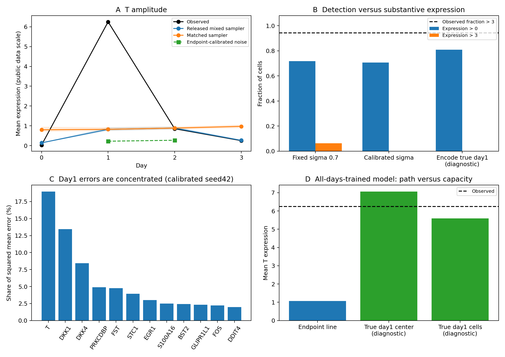

**Squidiff 复现诊断报告：day1 的差距、证据边界与停止条件**

审查日期：2026-11-15。对象：本目录中的 iPSC 分化实验为主，Norman 双扰动实验为辅。约束：只使用公开资源和现有本地制品，不以向作者索取权重作为后续前提。

**我的判断是：可以结束当前这轮“按公开 Squidiff 协议从头复现”的工作；不建议继续盲目增加训练步数或寻找幸运种子。** 现有结果足以说明，在已经检验的数据与设置上，模型没有可靠恢复真实 day1 瞬态状态。不过，“工程复现失败”“论文图表完全不能复现”和“论文的生物学解释缺少充分支持”是不同判断。这里最有证据支持的是第三种，同时存在固定公开采样参数不能稳定迁移到重新训练模型的问题。

不能称当前工作已经排除了所有实现影响：未经改写的原始训练循环整程对照仍未完成，原始基因名单和划分不可精确恢复，还发现了一个值得检查的 HVG 对数底问题。但这些剩余事项更可能解释分数和稳定性的变化，尚无证据表明它们能让只看端点的模型恢复真实 day1 程序。若目的是发表严格的复现研究，可以再做一次有明确边界的原训练循环对照；若目的是判断这条路线是否值得继续投入，现有证据已足以停止。

这也不足以指控作者造假或故意夸大。较准确的评价是：**公开展示的整体相关性、弱标记富集和生成轨迹，不足以独立证实“准确预测未见瞬态状态”这一较强解释。** 部分展示现象可以重现，但其解释存在混杂。

**1．本报告重新核验了哪些证据。** 我阅读了本地预处理、训练、扩散、采样、指标、校准和主要审计脚本，核对了作者 notebook 的实际代码与执行输出，并补读了正式发表论文对应的开放作者稿、补充材料及公开审稿文件。原有 `docs/paper_published.txt` 主要是出版网页的公开部分，不能当作已获得全部正文。[论文](https://www.nature.com/articles/s41592-025-02877-y)、[开放作者稿](https://pmc.ncbi.nlm.nih.gov/articles/PMC12872408/)、[公开审稿文件](https://static-content.springer.com/esm/art%3A10.1038%2Fs41592-025-02877-y/MediaObjects/41592_2025_2877_MOESM3_ESM.pdf)。

本次没有重新训练模型，没有改写历史预测、原代码或 README。新增的分析包括：

- 重新从 NPZ 和对应真实数据计算 **144 份 iPSC 预测**的均值指标，最大差异为 `4.44e-16`；基因顺序和数值有限性均通过检查。
- 直接核对历史归档清单中的 **1,029 个文件**，SHA256 全部一致。
- 用现有最终权重在 CPU 上重新计算五个模型的编码器几何，检查潜变量尺度的不可辨识性。
- 分解 day1 逐基因误差，比较 T 的非零比例与有实质幅度的表达比例，计算仅改变时间比例能改善多少，以及 HVG 对数底敏感性。
- 在线确认两个作者仓库的最新提交仍为本地固定的 `abdfc27d8494…` 和 `7ce6d0291ee4…`；Figshare 仍为 v3，已核查的公开权重是 BVO 制品，未发现匹配此处 Fig.2 iPSC 的权重。

可复算脚本是 [scripts/diagnose_day1.py](scripts/diagnose_day1.py)，新增表格和图位于 [results/diagnosis_20261115/](results/diagnosis_20261115/)，来源和运行环境记录见 [sources.json](docs/diagnosis_20261115/sources.json)。新分析使用独立的 Python 3.12/CPU 环境；原训练记录中的 Python 3.10、PyTorch 2.5.1/CUDA 设置没有被更改。本次 CPU 编码器检查不是一次新的 GPU 长程训练验证。

**2．首先校准预期：论文的 day1 本来就不是高精度恢复。** [发表版 Fig.2](docs/published_fig2.png) 的散点图标注 day1 Pearson `0.85`、day2 `0.90`。Fig.2g 的 day1 R² 柱高约为 `0.55–0.56`，且相对 scGen 标为 NS；这是读图近似值，不是作者提供的原始数值表。公开 notebook 留存了另一组精确输出：day1 Pearson `0.864539`、R² `0.654481`，day2 分别为 `0.912477`、`0.741939`。不同图、不同输出不能强行视为同一次运行。

更重要的是，作者的 `cal_metric()` 将预测均值传给 `r2_score()` 的第一个参数，算的是**以预测方差为分母的反向 R²**。本地同时保存了正确参考方向和 notebook 方向，这是必要修正，不是压低分数。定义为：

\[
R^2_{\rm truth}=1-\frac{\sum_g(y_g-\hat y_g)^2}{\sum_g(y_g-\bar y)^2},\qquad
R^2_{\rm notebook}=1-\frac{\sum_g(y_g-\hat y_g)^2}{\sum_g(\hat y_g-\overline{\hat y})^2}.
\]

下面只比较 day1；三种本地模型行均使用最终 100,000 步模型。`source` 的三种子共享一套数据划分；v1 与 source 的基因集合不同，不能直接据横向分数判定哪种训练更好。

| 结果或参照 | Pearson | 常规 R² | notebook 方向 R² | T 预测均值 |
|---|---:|---:|---:|---:|
| 作者 notebook 留存输出 | 0.8645 | 未给出 | 0.6545 | 未给出精确值 |
| 本地 v1，固定 σ=0.7 | 0.8943 | 0.7009 | 0.6253 | 0.6292 |
| source 三种子，固定 σ=0.7 | 0.7534 | 0.3670 | 0.1079 | 0.8256 |
| source 三种子，独立端点验证选择 σ | 0.8089 | 0.6491 | 0.5411 | 0.2227 |
| source 精确表达线性基线 | 0.7992 | 0.6291 | 0.5336 | 0.1086 |

真实 source day1 的 T 均值是 **6.2501**。因此有两个同时成立的事实：整体分数可以达到论文展示的量级；恢复真实 day1 瞬态幅度仍然非常差。不能把 `6.2501` 当成“作者报告的预测值”，它是公开数据的实测值。固定 σ=0.7 的 source 组确实没有达到作者留存的数值；经过端点校准得到相近量级，也不能称为原始固定参数的精确复现。[作者 notebook](upstream/Squidiff_reproducibility/squidiff_on_differentiation.ipynb)、[作者指标函数](upstream/Squidiff/sample_squidiff.py)、[重新核算表](results/diagnosis_20261115/recomputed_metrics.csv)。

线性基线进一步改变了问题的重心：source 校准模型的 day1 MSE 相对精确端点均值插值平均降低 **5.37%**，day2 降低 **5.31%**。若给基线同样的真实输入 day0 群体，day1 增益约为 **4.69%**，day2 为 **3.54%**。这是有限的有效改善，不能说完全无效，也远不是准确恢复中间态。[同输入基线](results/research/input_conditioned_baselines.csv)。

**3．day1 失败是成组的状态预测错误，不是 T 单个基因拖累了所有指标。** 对 source seed42、端点校准后的 day1 重新分解误差，得到：

| 基因 | 真实均值 | 预测均值 | 占全部均值平方误差 |
|---|---:|---:|---:|
| T | 6.250 | 0.240 | 18.98% |
| DKK1 | 5.431 | 0.375 | 13.44% |
| DKK4 | 4.911 | 0.907 | 8.43% |
| PRKCDBP | 1.735 | 4.790 | 4.91% |
| FST | 5.354 | 2.340 | 4.77% |
| STC1 | 0.341 | 3.081 | 3.95% |

前三项合计占 **40.84%**。以真实 day1 均值超过两个训练端点较大均值至少 `0.5` 为定义，13 个瞬态上调基因贡献了 **56.25%** 的误差；三个校准模型均未把其中任何一个预测为达到该阈值的瞬态上调基因。其余错误还包括未正确下降的基因，不能只围绕 T 设计补丁。[逐基因误差](results/diagnosis_20261115/day1_error_genes.csv)、[瞬态程序检查](results/research/transient_programs/precision_recall.csv)。

去掉 T 后，seed42 的 R² 从 `0.6472` 升到 `0.7024`，对应线性基线为 `0.6867`：仍是小幅改进。已有不使用 T 的事后日龄分类器，对真实 day1 的识别率为 **94.83%**，对这个模型的生成 day1 则为 **0%**；约 69.8% 被归为 day0，28.3% 被归为 day3。这个分类器本身接触真实四天数据，仅能作为辅助分布诊断，不能当作预测模型的一部分，也不能凭一次分类器结果独立宣布失败。[分类结果](results/ipsc/source_fp32_s42/population_audit/endpoint_validated_noise_without_T.csv)。



图 A 的范围来自三训练种子×三采样重复，不是生物学置信区间。B、C 使用 source seed42；B 的“编码真实 day1”使用只训练端点的模型，是诊断。D 使用额外见过四天训练数据的阳性对照，后两项显式获得真实 day1 潜变量，不能计为端点预测成功。

**4．最主要的结构性原因：训练目标不识别 day1 轨迹。** 实际目标可以简写为：

\[
\mathbb E_{x\sim P_0\cup P_3,\,t,\,\epsilon}
\left\|\epsilon-\epsilon_\theta\bigl(\sqrt{\bar\alpha_t}x+
\sqrt{1-\bar\alpha_t}\epsilon,\,t,\,E_\phi(x)\bigr)\right\|^2.
\]

这里的 `t` 是扩散噪声时间，不是生物学日龄。网络接触的是端点细胞及其自身编码，未训练“端点之间的某个插值潜变量应解码成真实 day1”。推理时才人为指定：

\[
z(d)=\overline{E(x^{\rm source}_0)}+\frac d3
\bigl(\overline{E(x^{\rm train}_3)}-\overline{E(x^{\rm train}_0)}\bigr)+\sigma\eta.
\]

“能够去噪和重建”并不自动推出“潜空间直线就是发育轨迹”。源码没有中间时间监督、轨迹一致性、已知调控网络或培养刺激时序的约束，也没有把潜空间训练成满足线性发育假设的专门目标。[训练损失](upstream/Squidiff/Squidiff/diffusion.py)、[编码器与解码器](upstream/Squidiff/Squidiff/MLPModel.py)。

从可辨识性看，只给定端点均值，路径
`m(s)=(1-s)m0+s*m3+h(s)*v` 中任意满足 `h(0)=h(1)=0` 的中间起伏都与端点一致。非线性生成器允许出现这样的起伏，但端点训练数据没有直接告诉它哪个起伏、哪个基因及多大幅度才是真实的。**这是无法由端点信息唯一确定的问题，不是声称所有端点预测在数学上都不可能。** 端点异质性、跨任务先验或其他观测可以提供帮助；本实验没有充分证明这些信息已足以识别目标路径。

数据也说明模型面对的不是轻微均值漂移：source 训练 day0 的 1,200 个样本中，T 非零只有 27 个、表达大于 3 的只有 6 个；day3 相应为 105 和 46 个。真实 day1 测试样本中，**94.33% 的 T 表达大于 3**。训练并非完全没有见过高 T，而是没有见过“几乎整个群体都处于高 T，且伴随其他 day1 基因关系”的状态。T 的 day1 峰在全量数据及既有 88 个合格供体的检查中也存在，不能主要归咎于这 600 个测试细胞抽得不巧。[本次支持度检查](results/diagnosis_20261115/T_support.csv)、[全量与供体检查](results/research/raw_dynamics/summary.json)。

**5．新的潜空间诊断表明，偏差不只是时间比例没调好。** 对最终编码器重新计算，在 source seed42 中，训练 day0/day3 潜变量中心距离为 `1.194`；真实测试 day1 中心到**整条无限长端点方向直线**的最短距离为 `1.461`，到指定 `1/3` 点的距离为 `1.462`。最接近真实 day1 中心的比例约为 `0.283`，调整比例几乎不减少这段距离。seed43、44 的最短距离分别为 `1.391`、`1.443`，结论一致。[潜空间几何](results/diagnosis_20261115/latent_geometry.csv)。

这属于用真实中间态定位问题的事后检查；对只训练端点的编码器而言，真实 day1 编码本身也可能失真，所以不能单凭这些距离证明生物学轨迹的真实形状。但四天训练的阳性对照给出了更直接的支持：

| 同一个四天训练模型的 day1 输入方式 | T 预测均值 | 常规 R² | 含义 |
|---|---:|---:|---|
| 仍沿 day0/day3 连线，σ=0.7 | 1.069 | 0.8255 | 见过 day1 后，旧插值规则仍恢复不足 |
| 使用训练 day1 的潜变量中心 | 7.067 | 0.9763 | 网络能够表达高 T 状态；需要正确条件位置 |
| 编码真实测试 day1 细胞 | 5.592 | 0.9954 | 容量/重建阳性对照，不是预测 |
| 真实测试 day1 | 6.238 | — | 该组使用 v1 的固定测试细胞 |

四天模型真实 day1 中心到端点方向直线的距离仍为 `1.303`，而最优比例 `0.327` 已非常接近 `1/3`。**提供中间态训练信息解决了“能否表示”，却没有自动解决“如何从端点找到它”。** 这使得单纯增加训练量、扩大模型或改变时间刻度，成为相对不充分的解法。[阳性对照结果](results/ipsc/all_days_fp32_s42/research_eval/raw_controls/metrics.csv)。

另一个仅用于解释的上界检查：在 source 表达均值的线段上，允许直接用真实 day1 选择最有利的时间比例，也只把线性基线 R² 从 `0.6291` 提高到 `0.6396`，仍保留 **97.18%** 的原平方误差。这个上界只针对表达线性基线，不是非线性 Squidiff 解码器的性能上界；它说明“真实 day1 只是更早/更晚的平均端点混合”不足以解释问题。[时间比例诊断](results/diagnosis_20261115/expression_clock_oracle.csv)。

**6．固定 σ=0.7 是可确认的推理问题，但调好它也不能恢复瞬态程序。** source 三个模型的端点组内潜变量每维 RMS 标准差约为 `0.423–0.429`。σ=0.7 相当于其 **1.63–1.66 倍**，每维方差约为经验值的 2.7 倍。60 维噪声的 RMS 长度是 `0.7√60≈5.42`，而 day0→day1 的平均方向移动只有约 `0.40–0.42`。这个比值说明采样受到噪声尺度强烈影响，不能单独用来断言所有样本都在训练支持之外。

σ 不可直接移植的原因还不仅是某个种子没有训练好。当前编码器末层为线性层，解码器通过各块的 `zsem_dense` 读取它。作如下参数变换：

\[
E'(x)=cE(x),\qquad W'_z=W_z/c,
\]

端点条件下的去噪函数可以保持不变，但继续给新潜空间加固定 `0.7` 噪声，相当于在旧潜空间加 `0.7/c` 噪声。**训练目标没有给 0.7 确定的物理或统计意义。** 内部 BatchNorm 也没有固定最后一层的尺度。本次在 seed42 最终权重上取 `c=2`，编码器缩放误差和一次去噪前向输出误差均为 **0**。这验证了参数化层面的尺度自由度，不是一次完整新采样实验。[尺度检查](results/diagnosis_20261115/latent_scale_invariance.json)。

端点验证选出的 σ≈0.42 明显改善整体误差：seed42 的端点验证 Wasserstein 从 σ=0.7 时的 `1.330` 降到 `0.671`；day1 R² 从 `0.343` 提高到 `0.647`。但 T 从 `0.910` 降至 `0.240`，仍远低于 `6.250`。这不是校准“破坏了正确生物学”，更符合大噪声带来额外非特异表达、同时恶化整体分布的解释。[噪声校准候选](results/ipsc/source_fp32_s42/noise_validation/candidates.csv)。

也不要把希望过度寄托于复杂协方差采样：本次端点残差协方差条件数仅约 `6.2–6.7`，有效维数约 `57/60`，没有发现极端退化的证据。协方差匹配可以做，但不会凭空补上缺失的 day1 方向。保留细胞异质性的 `cell_shift` 已经试过；其三种子 day1 R² 约 `0.640`、T 约 `0.165`，不能再把“不要只用中心，改用逐细胞平移”列为尚未尝试的救命措施。

**7．原推理协议混用两种采样方式，会制造弱中间日富集。** 公开 notebook 在 day0、day3 编码真实端点细胞后重建；在 day1、day2 改为“潜变量中心＋方向＋0.7 高斯噪声”。四天曲线因此同时改变了生物学位置和潜变量分布。已有三模型×三噪声重复的负对照很关键：不施加分化移动，仅给 day0 中心加同样噪声，T 已约为 `0.80`；day1 约为 `0.82`。统一四天的采样方式后，九条曲线都没有中间日高于两端的富集。[负对照逐点数据](results/research/sampling_curve_comparison.csv)。

因此，原混合采样下出现 day1/day2 高于重建端点的 T，不足以说明网络学到了真实瞬态峰。需要至少同时满足：同一种采样规则下仍有峰、峰有正确的基因特异性和幅度、无方向移动的噪声负对照不能解释它。这些条件目前没有满足。

固定 σ=0.7 也并非完全不预测瞬态上调，而是产生大量错误上调。按同一个 `0.5` 阈值，三个 source 模型分别报出 57、50、68 个瞬态基因，其中真阳性只有 4、4、5 个，precision 约 **7%–8%**。仅报告“恢复了几个瞬态基因”会漏掉这一代价。

公开 dotplot 采用默认表达阈值时也容易造成乐观视觉印象。本次 seed42 校准后 **70.67%** 的生成 day1 细胞 T 大于零，但**没有一个大于 3**，真实比例却是 94.33%。σ=0 的中心采样甚至能让约 94.8% 的细胞 T 大于零，而均值只有 `0.057`。连续生成的小正数与真正高表达细胞不是同一回事。[重新核算的阈值比例](results/diagnosis_20261115/recomputed_metrics.csv)。

**8．基因集合是整体分数差异的重要来源，当前还有一个值得保留的新线索。** v1 与 source 都是 203 维，但只重合 **91 个基因**。已有固定细胞、只改变特征发现抽样种子的检查中，十套基因表的 day1 线性基线 R² 从 `0.6056` 到 `0.8130`，无需训练模型就能产生这么大的分数变化。直接比较 v1 `0.70`、source `0.37` 或论文 `0.55`，很容易把任务难度变化误判成优化器好坏。[已有 HVG 敏感性](results/research/hvg_sensitivity/fixed_cells_variable_features.csv)。

预处理本身有几处必须区分的事实：

- 作者代码实际是 **200 个 HVG 与 NANOG/T/GATA6 的并集**，不保证总数永远等于 203。训练时应按实际列数建模，不能为凑维数随意删补基因。
- 原 notebook 的 Leiden 筛选被后续 `new_adata = adata` 覆盖；本地 source 不再执行该筛选，符合公开代码的顺序。缺少作者原数据分区，仍不能保证这就是发表图实际使用的状态。
- 原代码放回抽样后再切分。source 训练 2,400 行实际只有 2,237 个唯一细胞，与测试集重合 163 个端点 ID；day1/day2 不进入模型训练。这个重合可能抬高端点成绩，不能解释为中间态训练泄漏。
- source 和 v1 的 HVG 发现使用了四天独立发现分区。中间日未用于拟合扩散参数，不等于整条流程完全不知道中间态。严格端点特征选择的新分区已经做过，其校准后 day1/day2 相对各自基线仍差约 1.9%/21.5%。

**新增的对数底线索应作为敏感性问题处理。** 原数据作者对同一内胚层数据的后续分析明确写出 scran 归一化及 `log2(x+1)`；原数据仓库也使用 `logcounts` 和 scran/scater 的处理链。另一方面，Scanpy 1.10.4 的 Seurat HVG 实现，在没有 `adata.uns['log1p']['base']` 时直接执行 `expm1(X)`，即把输入视为自然对数。作者 Fig.2 notebook 和本地构建 AnnData 的代码均没有设置这个字段。[数据作者的分析说明](https://pmc.ncbi.nlm.nih.gov/articles/PMC9380406/)、[原数据处理代码](https://github.com/single-cell-genetics/singlecell_endodiff_paper/blob/main/merging_and_qc/merge_sce.ipynb)、[Scanpy 1.10.4 实现](https://github.com/scverse/scanpy/blob/1.10.4/src/scanpy/preprocessing/_highly_variable_genes.py)。

本次固定 source 发现细胞，**不改变模型表达值，只在 HVG 计算前声明 base=2**，得到 202 个基因，与原 source 名单重合 135 个；同一细胞群上的线性 day1 R² 从 `0.6291` 变为 `0.5919`。单独将同一发现矩阵的 HVG 计算从 float32 改为 float64，则仍得到相同的 203 个基因。这说明对数底的影响不可忽略，也说明“修正处理”不一定提高报表分数。[对数底敏感性](results/diagnosis_20261115/hvg_log_base.csv)。

当前尚未完整重建这个 CSV 的最初导出链条，所以不把它写成已经确认的唯一数据错误。即使确认输入是 log2，这也是公开代码与本地共同存在的问题，**不能直接解释作者成功、本地失败**。它值得成为后续方法实验的一项预处理修正，但不是已经验证的 day1 救援。更不能把已训练模型的输入直接乘 `ln(2)` 再推理；更换尺度或基因表都需要对应的重新训练与公平评估。

**9．优化与容量确有问题，但“训练还不够”不是目前最合理的解释。** 本次实算原 203 维网络参数约 **5,214 万**，source 训练只有 2,237 个唯一端点细胞。作者所谓 `100000 epochs` 在实际 `TrainLoop` 中是 100,000 次更新，每次取新打乱 DataLoader 的第一个 batch，不是完整遍历数据十万次。batch64 共约 640 万次样本呈现，相当于按 2,400 行计算约 2,667 个全数据遍历量。不能因为表格写了 epochs，就再把训练量放大几十倍。[原训练循环](upstream/Squidiff/Squidiff/train_util.py)。

source seed42 的固定验证方案下，验证去噪损失在 10k 时约 `0.523`，100k 时升至 `1.157`，与过拟合或端点泛化变差一致。训练损失和验证损失使用的时间步分布不同，不能只比较二者绝对大小宣布过拟合；**同一个验证定义随训练恶化**才是这里的有效证据。50k、EMA、v1 的端点生成校准都已检查过，没有恢复 day1 T。[训练记录](results/ipsc/source_fp32_s42/train.jsonl)、[50k 评估](results/ipsc/source_fp32_s42/research_eval/step050000_controls/metrics.csv)、[EMA 评估](results/ipsc/source_fp32_s42/research_eval/ema_controls/metrics.csv)。

扩大到 16,546 个端点训练细胞后，验证损失改善到约 `0.290`，校准 day1 R² 达到 `0.8338`，但对应同基因基线已是 `0.8245`，T 仍仅 `0.208`。因此更多端点细胞确实改善估计和泛化，却没有解决瞬态状态识别。这个实验只做了一个种子，且使用 v1 特征表，不能拿 `0.8338` 直接与 source `0.6491` 宣称巨大方法进步。[全端点结果](results/ipsc/full_endpoints_fp32_s42/research_eval/endpoint_validated_noise/metrics.csv)。

| 已经检验的方向 | 现有证据允许得出的结论 |
|---|---|
| 移除 BF16、再关闭 TF32 | 一般数值精度不是主要失败解释；不能排除所有软件栈影响 |
| 原 CPU DataLoader 和 NumPy 时间步抽样 | source 三种子仍失败；GPU 抽样适配不是必要原因 |
| 100k 最终模型、50k、EMA、端点校准 | 没有出现可靠的瞬态恢复；并非所有 checkpoint 都穷尽检查过 |
| 原采样 API 直接运行 | 固定公开采样规则本身也会给出差结果 |
| 新细胞分区、端点专属 HVG | 问题不依赖原来那一批细胞或中间日特征发现 |
| 全端点扩充 | 缓解过拟合，没有恢复 day1 峰 |
| 四天训练阳性对照 | 网络可以表示 day1；仅靠端点插值仍不够 |

**10．实现可信度较高，但需要准确描述已有检查的强度。** 本地训练直接使用作者模型与扩散模块，主要改写了入口、抽样、优化、记录和恢复。source 组对齐了 FP32、非 fused AdamW、原抽样方式、学习率更新时序以及固定最终步数。原采样器与本地同随机流输出一致，扩散公式和时间映射也做过核验。[实现检查](results/research/implementation_audit.json)。

不过，`implementation_audit.py` 中真正对原 `TrainLoop.run_step()` 的核验只有五步，并且对照本地 fused 优化器，最终参数/缓冲区最大误差约 `3.27e-6`。`native_resume_audit.py` 中的五步逐位一致，验证的是**同一本地更新过程恢复前后**的一致性，不是未经改写原训练循环与本地实现整程等价。因此不能将二者合起来表述为“原版完整训练已经逐位验证”。已有 README 对整程对照缺失有所保留，本报告认为这项保留应继续明确。[恢复检查代码](scripts/native_resume_audit.py)。

还存在三项公开实现本身的边界，不宜误当作本地复制错误：

- 补充图将模型描述为残差结构，但当前 `MLPBlock.forward()` 没有通常的 `x + f(x)` 块级跳连；加入时间和语义投影不等于这种跳连。若新增跳连，应标为结构扩展。
- `clip_denoised=False` 仍然执行 `x.clamp(0)`，不是完全不裁剪。它适合当前非负表达输入，却意味着直接改成 z-score 输入会与采样逻辑冲突。截断也可能产生低表达基因的正偏置，但其对 day1 的因果贡献尚无独立消融，不能把它认定为主因。
- `predict_xstart` 等上游风格配置项不能想当然地直接使用：当前 `p_mean_variance()` 仍无条件走 `_predict_xstart_from_eps()`。若改为预测 x0 或 v，必须同时修改训练目标和反向换算，不能只改一个 flag。

这些点支持“公开实现还有改进空间”，不支持“随手补一个通用扩散技巧就能重现真实中间态”。若做最后的原生训练对照，还需注意原 CLI 用 `type(value)` 解析参数，显式传入字符串 `False` 会被 Python 的 `bool()` 转为真；应保留正确的布尔默认值，或用传入真正 Python 布尔值的启动包装。当前本地训练入口不受这一原 CLI 问题影响。[模型实现](upstream/Squidiff/Squidiff/MLPModel.py)、[反向扩散实现](upstream/Squidiff/Squidiff/diffusion.py)、[原训练入口](upstream/Squidiff/train_squidiff.py)、[补充材料](docs/supplement.pdf)。

**11．评估展示本身也需要更严格的解释。** 以下几项会让一个生物学预测一般的模型显得很好：

| 现象 | 实际能说明什么、缺少什么 |
|---|---|
| 跨基因均值 Pearson 很高 | 说明整体表达排序接近；共同表达背景和线性基线就可能做到，不等于准确恢复变化 |
| day0/day3 几乎完美 | 公开 notebook 直接编码真实对应端点，主要是重建；尤其 day3 不能直接当作从 day0 外推的成绩 |
| 六次结果方差很小 | notebook 在同一加载权重上循环生成六次，证明采样稳定；不能由此确认六次独立训练。论文原始运行是否另有重训，公开 notebook 不足以判断 |
| 生成轨迹上有平滑 pseudotime | 在生成数据上重新排序可检验内部一致性，不能替代与真实未见轨迹的对应验证 |
| 热图中间状态有“特异基因” | 公开代码在生成数据自身上选 DE 基因并缩放；需要用独立真实数据定义基因后再检验恢复 |
| notebook MMD 很小 | 其输入是每个基因均值作为一维样本；打乱基因身份也不改变这个 MMD，不能据此确认细胞联合分布恢复 |

作者 notebook 的 day3 调用是 `pred(z_sem_test_day3)`；本地 `official_api` 真正从 day0 平移到 day3 后，seed42 R² 约为 `0.719`，明显区别于端点重建高分。这是公开调用方式之间的区别，不等于已经证明论文全部 day3 图都用了同一种方式。[原 notebook](upstream/Squidiff_reproducibility/squidiff_on_differentiation.ipynb)、[直接原 API 结果](results/ipsc/source_fp32_s42/official_api/metrics.csv)。

本地已经增加的精确基线、gene-wise Wasserstein、联合表达 energy distance 和负对照，评估方向是正确的。还应保留以下限制：三个训练种子只反映固定数据下的优化不确定性；细胞 bootstrap 没有覆盖供体、批次或重新选 HVG 的变异；多轮查看过的测试集现在是诊断开发集，不能再作为新方法的一次性最终确认集。day1 的幅度差距很大，不依赖某个 p 值才能成立；较小的 5% 均值改善则尤其需要独立供体/批次验证。

**12．Norman 的结果与上述解释一致，但应保留模型确实带来的小幅收益。** 三个 source 模型使用全部 7,353 个控制细胞后，表达 R² 平均 `0.98344`，线性基线 `0.98215`，MSE 平均降低 `7.22%`。交互残差
`I=μAB−μA−μB+μCtrl` 的 R² 却只有 `0.030–0.083`，均值 `0.0623`。这个差别并不矛盾：表达预测和交互预测的误差分子相同，参考方差分母不同；该组表达均值方差约为交互残差方差的 72 倍。[三种子摘要](results/research/source_all_control_seed_summary.csv)、[尺度说明](results/research/r2_scale_explanation.json)。

原 notebook 的一维潜变量中心被再次 `.mean(axis=0)` 压成标量，确实是形状问题；本地已经保留 literal、正确中心和逐细胞推理，不能把它继续列作未修复主因。条件平衡训练也已尝试。1000 基因原版连训练细胞的生成都不稳定，应该归类为生成失败；epsilon 残差扩展虽然稳定些，却仍欠拟合。**Norman 的 1000 维失败不能外推成 iPSC 增加基因一定失败，也不能作为原 203 维生物学能力不存在的直接证据。**

对 Norman 最准确的表述是“均值预测有小幅改善，强非加性交互恢复未得到验证”。同样不应把编码真实 AB 后的高重建分数算成未见双扰动预测。公开审稿意见已经提出高总体相关性可能掩盖扰动变化的问题；当前残差评估是在实质回应这一问题，而不是额外挑一个不利指标。[审稿文件，第 18–19 页](docs/diagnosis_20261115/peer_review.pdf)。

**13．剩下哪些工作值得做，应按目标区分。** 我建议首先冻结当前结论和主表，不再以 day1 分数或 T 峰为依据选择种子、基因名单、训练步数。以下优先级是基于现有证据的判断，不代表改进已经成功。

| 优先级与方向 | 具体做法 | 它能回答什么 | 我的预期 |
|---|---|---|---|
| 可选收尾：原训练循环整程对照 | 固定现有 source 数据、seed42、100k 更新，用未经改写 `TrainLoop`；保留源码/环境哈希。分别报固定 σ=0.7 和端点校准结果 | 排除本地训练入口长期累积影响 | 对严谨归因有价值；救回真实 day1 的依据较弱 |
| 预处理敏感性：对数底 | 先闭合 CSV 的归一化来源；HVG 显式处理 base=2，表达值保持一致；实际维数决定网络维数 | 判断特征不稳定是否部分来自错误逆变换 | 可能改变整体分数和训练，尚无瞬态恢复证据 |
| 推理改进：尺度与条件分布 | 保留已经实施的端点校准；若继续，比较经验残差/协方差或有明确细胞配对依据的端点运输 | 检验潜变量采样失配 | 有限价值；逐细胞平移已失败，不能承诺结构性改善 |
| 优化改进：更小网络、正则化、早停 | 只以独立端点验证选配置，同时检查重建与一致采样分布；先限一个小规模对照 | 减少过拟合，改善数值与端点泛化 | 可能改善误差，通常不提供缺失的日龄信息 |
| 方法研究：真实轨迹信息 | 利用公开同谱系时间序列、额外中间态、外部调控先验或培养刺激时序，并加入路径约束 | 使中间态轨迹获得额外可识别信息 | 最有希望改变生物学结果，但已超出原论文纯端点协议复现 |

对数底或更多基因实验必须使用同一评估基因集合，或至少同时报告共同基因集合和各自匹配的基线；不能把不同面板的原始 R² 直接相减。不要把 203 视为必须维持的神奇数字。若研究大基因面板，可从 500 维开始，先验证训练细胞/独立端点生成稳定，再评价中间态，避免重复 Norman 中“采样已经失控却继续解释生物学分数”的问题。

潜变量噪声增强、重建一致性、时间条件网络、带先验的曲线路径或端点运输都可以是新方法；**仅从两个端点学习的更平滑路径，仍不自动包含真实的 T/DKK 瞬态峰。** 若引入外部时间序列，应明确训练中获得了什么额外信息，用供体或实验批次隔离最终测试，并与简单表达基线、简单轨迹基线比较。若只在当前 day1 上调参成功，应报告开发集改进，不能称为新的独立复现成功。

不建议再优先投入：更多同一划分训练种子、把 100k 更新误读成 100k 完整 epochs、扫描 σ 直到 T 看起来像论文、重画 UMAP 或换热图色标、仅提高生成细胞数、只调瞬态阈值，或对当前正值采样器直接喂入 z-score 数据。它们或已被实质检查，或只能改变方差/展示，或会引入新不一致。

**14．明确的停止条件。** 如果目标是“判断公开 Squidiff 能否在这两个任务上支持较强的瞬态/交互预测结论”，我建议现在归档结束；保留阴性结果和小幅正收益，已经比单次高相关性复现更有信息量。

如果希望在对外报告前补上最后一个实现归因缺口，可以把收尾预算严格限定为**一次原 `TrainLoop` 的完整 source 对照**。评价前冻结主指标：同基因基线增益、T/DKK 等真实瞬态基因幅度与错误上调率、统一采样负对照、联合分布，以及端点生成质量。不要只选一个超过阈值的 R² 作为成功。若它仍表现为“端点可重建、均值略改善、真实瞬态不能恢复”，这轮公开协议复现即可正式关闭，无须继续以拿不到作者权重为由悬而不决。

若该对照意外恢复了真实 day1，应先定位与本地入口的具体差异，再在至少一个独立数据划分上确认，而不是回头挑选最像论文的一次运行。若决定做对数底或结构扩展，则另立方法实验记录，不延长原始复现直到碰巧得到满意结果。

建议对这轮工作使用的最终表述是：

> 在可获得的公开数据与实现基础上，我们完成了从头训练和多项实现、数值、数据及采样对照。整体表达相关性在部分设置下可达到论文展示量级；相对匹配线性基线存在有限均值收益。但 iPSC day1 的真实瞬态程序和 Norman 的强非加性交互未得到可靠恢复。原始运行无法逐点重放，主要生物学预测结论未在当前公开协议检验中获得支持。

**15．证据索引与复算方式。** 下列材料应与报告一起保留，避免只保存结论性文字。

| 证据 | 文件 |
|---|---|
| 本次独立分析脚本 | [diagnose_day1.py](scripts/diagnose_day1.py) |
| 144 份预测的重新核算与哈希 | [recomputed_metrics.csv](results/diagnosis_20261115/recomputed_metrics.csv)、[prediction_integrity.json](results/diagnosis_20261115/prediction_integrity.json) |
| 全部旧归档文件的内容核验 | [archive_hash_check.json](results/diagnosis_20261115/archive_hash_check.json) |
| day1 误差、T 支持度 | [day1_error_genes.csv](results/diagnosis_20261115/day1_error_genes.csv)、[T_support.csv](results/diagnosis_20261115/T_support.csv) |
| 潜空间几何与尺度等价检查 | [latent_geometry.csv](results/diagnosis_20261115/latent_geometry.csv)、[latent_scale_invariance.json](results/diagnosis_20261115/latent_scale_invariance.json) |
| 时间比例与 HVG 新检查 | [expression_clock_oracle.csv](results/diagnosis_20261115/expression_clock_oracle.csv)、[hvg_log_base.csv](results/diagnosis_20261115/hvg_log_base.csv) |
| 原有完整实验表 | [all_controlled_metrics.csv](results/research/all_controlled_metrics.csv) |
| 公开原方法与执行顺序 | [模型代码](upstream/Squidiff/Squidiff/MLPModel.py)、[Fig.2 预处理](upstream/Squidiff_reproducibility/preprocess_fig2_data.ipynb)、[Fig.2 推理 notebook](upstream/Squidiff_reproducibility/squidiff_on_differentiation.ipynb) |
| 资料与新分析环境 | [sources.json](docs/diagnosis_20261115/sources.json)、[公开作者稿正文](docs/diagnosis_20261115/paper_author_manuscript.txt)、[审稿文件](docs/diagnosis_20261115/peer_review.pdf) |

在具备 NumPy、pandas、SciPy、AnnData、scikit-learn、PyTorch、Matplotlib 和 Scanpy 的环境中运行：

```bash
python scripts/diagnose_day1.py --latent --hvg
```

需要本机现存的数据、预测和 `step_100000.pt`；仅下载 Git 归档而没有数据/权重时，不能执行全部新诊断。脚本只向 `results/diagnosis_20261115/` 写新分析文件。当前旧归档清单不包含这次新增材料；本报告的完整性核验指历史文件内容保持一致，不是声称原归档清单已经自动覆盖本报告。
